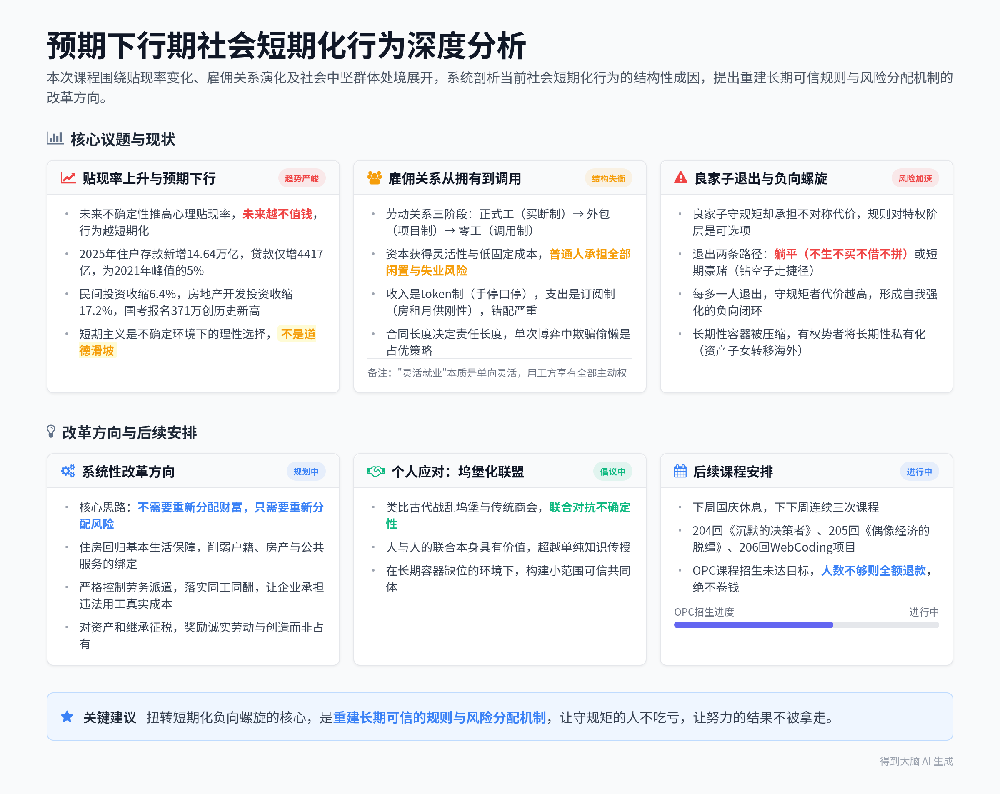

# 当人们看不到未来，每个人都会变成短生种——场会203期分享

> 本条由 2026-09-30 晚 1 段录音合并成一份，合计约 165 分钟；各段来源见下表，主段是时长最长的一段。

## 当晚分段

| 段 | 开始时间 | 时长 | 标题 | 来源 |
|---|---|---|---|---|
| 1 | 2026-09-30 19:55 | 165 分钟 | 当人们看不到未来，每个人都会变成短生种——场会203期分享 | https://biji.com/note/1922834757591925832 |

## 智能笔记

### 段 1｜当人们看不到未来，每个人都会变成短生种——场会203期分享（165 分钟）

### 智能总结

##### 录音信息
- **录音时间**：2026-09-30 19:55:00 ~ 2026-09-30 22:40:47
- **时长**：约 2小时 45分钟
- **参与人数**：约 1人（讲师+线上听众）
- **内容类型**：课程讲解 / 时政分析

##### 录音总结

本次课程围绕「预期下行期社会普遍短期化行为」展开深度分析，从贴现率变化、雇佣关系演化讲到社会中坚群体的处境，提出了当前社会结构层面的问题与改革方向。课程共178页PPT，内容尖锐坦诚，核心指出只有重建长期可信的规则与风险分配机制，才能扭转短期化的负向螺旋。

**开场与课程背景介绍**
* **开场打招呼**：开场对进入直播间的明哥、老万、文俊、空叉等听众打招呼，说明大过节听课人数少，课程内容可能引发不适，献给有缘人。
* **课程基本信息**：本次课程PPT共178页，是场会203会，为首次专门讲解国内形势的课程，核心开篇以China GT上海站撞车事故引入主题。
* **主题引入**：2026年9月5日China GT上海站事故中，对手车手49秒救出被困车手，主办方15分钟救护车才到，后续三支车队宣布退出，一支永久退出，由此引出核心观点：当人们看不到未来，每个人都会变成短生种。

**贴现率与预期下行对时间表的改变**
* **贴现率核心概念**：贴现率是将未来的钱折算为当下的比例，未来越不确定，贴现率越高，未来越不值钱。举例：10年后的100万，贴现率3%时当下值74.4万，10%时值38.6万，20%时仅值16.2万。
* **不同主体的行为变化**：居民选择多存钱、提前还贷，不愿意背长期债务；企业停止扩张，不做长期投资，少招长期员工，能外包就外包；年轻人放弃长期规划，拼命抢为数不多的确定性，扎堆考公上岸；地方政府抓当期收入，能不背长期负债就不背。
* **宏观数据验证**：2025年住户存款新增14.64万亿，住户贷款仅新增4417亿，贷款增量仅为2021年峰值的5%；2025年民间固定资产投资收缩6.4%，房地产开发投资收缩17.2%；2025年国考资格审查人数达371万，创历史新高，计划招录仅3.81万，比去年减少1600人。
* **核心结论**：短期主义不是道德滑坡，是不确定环境下的理性选择；指责个人短视既不公平也没用，核心问题是如何让未来重新变得可信；只有承诺可兑现、规则不随意改变、努力结果不被拿走，才能降低贴现率，回归长期主义。

**雇佣关系从拥有变成调用的社会变化**
* **劳动关系三次演化**：劳动关系和软件产品一样经历三次变化：从正式工（买断制，长期绑定，企业承担闲置成本）到外包（项目制，按期限结钱，无长期名分）再到零工（调用制，有活调用，没活无连接）。
* **成本与风险转移**：资本获得了灵活性、更低固定成本、轻资产高回报；代价是普通人丧失稳定性，福利变薄，承担全部闲置风险、收入波动和失业风险，出现「收入是token制，支出是订阅制」的错配：收入手停口停，房租、月供、学费等刚性支出必须按月支付。
* **一次博弈下的行为逻辑**：雇佣关系越短越接近一次性博弈，单次博弈中欺骗和偷懒是占优策略，声誉没有积累价值；只有重复博弈中，声誉才是可积累的资产，负责才是划算的选择。
* **长期关系的价值**：日本终身雇佣、德国双元制、中国传统师徒制/八级工体系的共同点，是让人相信长期投入有回报；企业不做长期承诺，就不能抱怨年轻人没有责任心，合同长度决定责任长度，真给终身合同，年轻人自然会有责任心。

**灵活就业的话语陷阱与公共服务问题**
* **灵活就业的原教旨与现实**：原教旨的灵活就业是劳动者自愿在收入保障和自由间权衡，本身没有问题；但现实中灵活是单向的，用工方可随时不要劳动者，劳动者却不能随时不干，被调用方没有不被调用的自由。
* **话语体系的问题**：把结构失衡问题重新定义为个人选择，将长期保障缺位包装成「获得自由」，这个话术至少为国家节省了大几千亿的社会保障支出，本质是让问题不需要被解决。
* **合同制公共岗位的问题**：很多地方消防员改成合同制，没有长期保障兜底，英雄的奖赏是长期兜底，合同制消防员拿打工的钱换命，出事没有身份保护；辅警也是同样的情况，一线干活出事推给临时工，没有人为结果负责。

**短生种与良家子的处境问题**
* **良家子的核心定义**：传统良家子家世清白，守法服从管理，按规则纳税服役，相信守规矩能换长期回报，要求规则被长期兑现，是王朝鼎盛时期赋税、兵源和基层秩序的核心来源。
* **当前良家子的困境**：规则对两类人标准不同，对良家子规则是长期合同，对特权阶层规则是可选项，可用可不用；良家子一直履行合同，对方却随时可以不履行，慢慢发现守规矩只约束自己，因此开始退出，形成负向螺旋。
* **短生种的生存逻辑**：短生种的特点是等不起、信不过，必须抓当下的现钱，这是不确定环境下的生存策略，不是道德问题；长生种有充裕时间做规划，不能用自己的道德标准指责短生种，位置不同，时间尺度不同。
* **长期容器的问题**：当前企业时间尺度是季度财报，雇佣关系是项目期日结，城市规划是一届任期，财政是年度预算借新还旧，规则因人而变，长期容器被压缩，普通人没有长期性的安放空间；而有权有势的人已经将长期性私有化，把资产子女转移到海外，只有普通人被迫接受短生种的时间尺度。

**地方政府短期化行为的成因**
* **任期与财政的双重约束**：党政领导法定任期是5年，但2001-2009年277个地级市市长平均任期仅3.2年，2013年离任的地市书记市长平均任期仅25-27个月，实际任期远短于法定任期，也远短于大项目5-10年的见效周期。
* **土地财政的本质**：土地财政是极致的短生种财政，住宅70年使用权，出让金一次性在一个任期内收完花完；2021年土地出让收入8.7万亿，2025年降到1.15万亿，2026年1-7月仅1.17万亿，占地方一般公共预算收入的比例从2020年的84%降到2025年的34%。
* **非税收入的问题**：土地财政退潮后，地方非税收入从2021年的2.98万亿增加到2025年的3.98万亿，四年增加一万亿，本质是增加企业负担，刮地皮补充财政缺口。
* **专职消防员执行矛盾**：2023年10月中央13部门发文要求专职消防员签劳动合同，严禁劳务派遣，但地方财政没钱，两年后仍有大量地方违规使用劳务派遣，因为劳务派遣是当年支出，第二年可砍，不需要承担跨任期的五险一金和安置负债，还能转移风险，违规成本低。

**短期化负向螺旋与良家子退出**
* **负向循环逻辑**：预期越差，短期行为越多，信任下降，交易成本上升，经济更差，预期进一步变差，形成自我强化的闭环。
* **良家子退出的两条路径**：第一条是躺平，不生不买不借不拼，不再投入长期，相当于退出社会竞争；第二条是短期豪赌，钻空子走捷径，做黑灰产，一次性博弈，结局往往更差。
* **博弈选择的演化**：如果我守规矩别人不守，我就会吃亏，理性的选择就是也不守规矩，每多一个人退出，剩下守规矩的人的代价就更高，螺旋不断加速，最终整个社会滑向黑暗森林。

**对建国初期理想主义的回顾与反思**
* **建国初期理想主义的根源**：建国初期最大的成就是重新定义了普通人与国家的关系，普通人第一次被称为人民，土地改革改变了农民与土地的关系，扫盲教育给了底层向上流动的机会，让普通人相信未来有自己，所以愿意为未来付出。
* **集体主义的浪漫**：那个时代人们相信国家变好就是自己变好，下一代变好就是自己的成果，愿意为了集体未来克制当下消费，这是集体主义才有的长期主义浪漫，社会主义接班人的本质，就是这一代没完成的事下一代接着做。
* **风险归属的变化**：过去就业、住房、医疗、养老大部分由单位集体兜底，现在风险转移给家庭和个人，风险个人化之后，人必然变得现实，所有事情都会用投入产出比衡量，读书是投资不是爱好，婚姻是条件组合，生育是长期负债。
* **理想主义失落的根源**：理想主义失落不是因为穷，也不是因为人性变坏，核心是成本所有人承担，收益少数人占有，普通人的苦变成了别人的财富，因此人们对宏大叙事开始本能警惕，问题结构隐身，所有问题都被归结为个人选择。

**改变方向与个人应对思路**
* **改革方向建议**：不需要重新分配财富，只需要重新分配风险；住房从家庭资产变回基本生活条件，削弱户籍、商品房和公共服务的绑定；缩小教育资源的区域校际差距，降低重病对家庭财务的摧毁性打击；公共服务按常住人口分配，严格控制劳务派遣，落实同工同酬，让企业承担违法用工的真实成本；对资产和继承征税，奖励诚实劳动和创造而非占有。
* **个人层面的思路**：提出做「坞堡化」联盟，类似古代战乱时期的坞堡，也类似传统商会，联合一群人共同对抗不确定性，比单独传授知识更有价值，除了知识之外，人与人的联合本身就有意义。

**课程收尾与后续安排**
* **课程说明**：说明本节课内容特殊，绝大多数课程还是讲AI、商业、WebCoding等具体项目，本节课是因为心有愤懑，作为知识分子不合周礼就要发言，这是自己的责任。
* **十月份课程安排**：下周国庆休息，下下周讲三次课，分别是204回《沉默的决策者》、205回《偶像经济的脱缰-时代峰峻商业模式分析》、206回WebCoding项目。
* **OPC课程招生情况**：OP课程目前招生未达到目标人数，还在招生周期内，如果人数不够就会退款，绝对不会卷钱，不涨价，招生按照原定规则推进。

**知识分享者的自我定位**
* 自认为骨子里是士农工商的士，是知识分子，不是纯粹的商人，知识分子在时代有问题的时候应当发言，默不作声就是有罪，哪怕冒风险也应该说真话，这是知识分子的担当。
* 真心希望国家变好，本次课程讲真话是出于爱国心，祝听众国庆快乐，做好自己，享受生活。

### 章节概要
**00:00:00** **开场打招呼与课程背景说明**

开场问候进入直播间的听众，说明大过节听课人数少，本次PPT共178页，内容可能让听众不舒服，属于献给有缘人的特殊课程。本次是场会203会，是首次专门讲解国内形势的课程，提前为内容可能扫了大家的兴致道歉。

**00:05:50** **China GT事故引入核心主题**

2026年9月5日China GT上海站发生撞车起火事故，对手车手49秒救出被困车手，主办方救护车15分钟才到，事故后三支车队宣布退出，一支永久退出。在歌颂车手勇气的同时，提出核心问题：为什么安全保障会缺位，引出核心主题：当人们看不到未来，每个人都会变成短生种，课程分为三个部分展开。

**00:08:00** **贴现率概念讲解与行为变化分析**

讲解贴现率的核心概念：贴现率是将未来的钱折算为当下的比例，未来越不确定，贴现率越高，未来越不值钱。举例验证：10年后的100万，贴现率3%时当下值74.4万，10%时38.6万，20%时仅16.2万。未来不确定性抬升每个人的心理贴现率，改变所有人的时间轴：居民选择多存钱提前还贷，企业停止长期投资，年轻人扎堆考公抢确定性，地方政府抓当期收入不背长期债。

**00:14:50** **宏观数据验证短期化趋势**

展示2025年的核心宏观数据：住户存款新增14.64万亿，住户贷款仅新增4417亿，贷款增量仅为2021年峰值的5%；全国固定资产投资不含农户收缩3.8%，民间投资收缩6.4%，房地产开发投资收缩17.2%；国考资格审查人数达到371万，创历史新高，计划招录仅3.81万，比去年少1600人。提出核心结论：考公热本质是短期世界里抢稀缺的长期确定性，编制热和日结化是同一原因的两个结果，大家对未来普遍悲观，因此不生不买不借，对长期承诺不再相信，同时抢确定性的长期合同。

**00:21:00** **当前年轻人低生育的结构性影响**

提出一个尖锐观点：现在城市白领年轻人主动选择不生，客观上帮助国家度过化债周期。化债周期中一定会有部分人阶级滑落，处理不好债务会变成老赖社会边缘人，如果这些人的孩子出生，会成为社会不稳定因素，因此他们主动丁克对国家而言是有利的。

**00:27:30** **短期主义的本质与负向螺旋逻辑**

提出短期主义不是道德滑坡，是不确定环境下的个人理性选择，每个人都做对自己理性的事，结果集体处境变差，形成负向螺旋：预期变差→所有人收缩→需求减少→收入变差→预期更差。同时指出，当前全球化建立的体系正在逐步崩塌，我们正在见证一百年未有之大变局，人类已经失去了战争这个传统的终极化债工具。改变行为的核心不是劝人长期主义，而是让未来重新变得可信，做到承诺兑现、规则稳定、努力结果不被拿走。

**00:35:50** **雇佣关系的三次演化逻辑**

类比软件产品从买断制到订阅制再到token调用制的变化，指出劳动关系也经历三次演化：从正式工长期绑定，企业承担闲置成本，到外包项目制按次结钱，再到零工调用制，有活调用没活无连接。资本越来越不愿意为闲置付费，固定成本转成可变成本，长期关系拆成一次性交易，核心变化是从「拥有」变成「调用」。

**00:44:20** **劳动关系变化的成本分配问题**

每次灵活化调整，资本获得收益，风险都转移给普通人：软件从买断变订阅，资本获得稳定现金流，普通人丧失所有权，必须持续付费；劳动从正式工变外包再变零工，资本获得更低成本、更高回报，普通人承担稳定性下降、福利变薄、全部闲置和失业风险。当前还存在严重错配：收入是token调用制，手停口停，支出是订阅制，房租月供学费必须按月刚性支付，错配让普通人压力极大。不为闲置付费本质就是不为责任和能力付费，灵活用工天然不需要承担社会责任。

**00:50:20** **企业盈利路径与一次性博弈逻辑**

提出企业赚钱有四种路径：造（创造新增价值）、挖（整合已有资源）、通（提升流转效率）、卡（设置门槛收费），当前的普遍情况是做造不如做挖，做通不如设卡，因为造是重资产长周期有风险，挖和卡轻资产高弹性短期就能见效。雇佣关系越短越接近一次性博弈，单次博弈中欺骗偷懒是占优策略，只有重复博弈才需要积累声誉、对结果负责，就像旅游景点宰客，因为游客大多一辈子只来一次，单次博弈宰客是理性选择。

**01:00:00** **星宇事件与地方政府选择问题**

星宇事件曝光后企业依然正常经营，核心原因是星宇是常州的龙头企业，涉及地方税收就业和KPI，对比几百个大学生的权益，地方选择牺牲大学生保住企业。提出问题：顾全大局的默认规则就是把普通人的前程当祭品，这种规则本身是否正确？企业到底应该为谁服务？地方政府到底代表谁的利益？指出长期雇佣才能让员工有动力积累声誉、投资技能、对结果负责，因为员工相信自己未来收入和企业绑定，会真心盼着企业好，现在员工不盼着企业好，是因为企业好了也没有自己的份。

**01:06:00** **长期雇佣制度的国际与历史经验**

日本终身雇佣用长期关系换取员工忠诚和专业技能积累，核心骨干依然保持长期雇佣；德国双元制，企业愿意为几年后才能上岗的员工提前投资；中国传统有师徒制和八级工体系，技能等级跟着人走，工龄越长越值钱，师傅有动力带徒弟。这些制度的共同点就是让员工相信长期投入有回报。现在合同期越来越短，35岁就被嫌弃，员工自然选择频繁跳槽，学通用技能随时准备走，企业抱怨年轻人没有责任心，其实这是合同期限导致的，不是代际问题，给年轻人真正的终身合同，年轻人自然会有责任心。

**01:09:00** **灵活就业的话语陷阱分析**

灵活就业的原教旨理论是劳动者可以在保障和自由间权衡，本身没有问题，但现实中灵活是单向的：用工方可随时不要你，你却不能随时不干，房租是刚性的，被调用方没有不被调用的自由。把结构分配问题重新定义为个人选择，将没有长期保障包装成拥有自由，这种话术至少为国家节省了大几千亿的社会保障支出，让问题不需要被解决。

**01:14:00** **合同制公共岗位的责任缺失问题**

现在很多地方消防员改成合同制，没有长期保障兜底，过去英雄牺牲了国家兜底，惠及子女，现在合同制消防员拿普通打工工资，要舍身救人，出事了推给临时工，没有身份保护。就像东航机场打人事件，组织不站在一线员工这边保护员工，员工自然不会对组织有责任感，长期预期不能用一次加薪替代，没有长期身份就没有长期责任。举例中国乒乓球，拆了陪练体系的长期编制，没人愿意牺牲自己做陪练，成绩自然下滑。

**01:20:00** **良家子的传统定义与核心特征**

解释良家子的传统含义：家世清白，不从事巫医商贾，家中有一定资产，服从管理，守法纳税服役，相信守规矩就能换长期回报，要求规则长期兑现，是王朝的中坚力量。举例水浒传里的宋江，就是标准的良家子，从头到尾一心想要招安，渴望得到朝廷认可。祁同伟也是良家子，近两年越来越多人支持祁同伟，本质是大家共情良家子被规则辜负的处境：规则对良家子是约束，对特权阶层是可选项，随时可以绕开规则。

**01:31:00** **短生种的生存逻辑与长期容器问题**

短生种的特点是等不起信不过，必须抓当下的现钱，这是生存策略不是道德问题，长生种有充裕的时间做规划，不能用自己的标准指责短生种，位置不同时间尺度不同。当前的核心问题是长期性容器被压缩：企业按季度财报考核，雇佣按项目日结结算，城市按一届任期规划，财政按年度预算借新还旧，规则因人而变，普通人没有存放长期目标的空间，而有权势的人已经将长期性私有化，把资产子女转移到海外，只有普通人被迫接受短生种的时间尺度。

**01:41:00** **地方政府短期化的成因分析**

地方政府官员法定任期是5年，但实际平均任期只有2-3年，远短于大项目5-10年的见效周期，因此新官不理旧账，只做任内能见效的项目，看得见的景观优先，看不见的管网消防养老往后排。土地财政本身是极致的短生种财政，70年的土地收益一次性在一个任期收完花完。土地出让收入从2021年的8.7万亿降到2025年的1.15万亿，占地方财政收入比例从84%降到34%，退潮后地方只能增加非税收入，四年增加了一万亿，本质是刮地皮，增加企业负担。

**01:52:00** **专职消防员执行偏差的核心原因**

2023年10月中央13部门发文要求地方政府招专职消防员必须签劳动合同，严禁劳务派遣，要求给五险一金和退出安置。但文件出台两年后，依然有很多地方违规用劳务派遣，核心原因是财政期限问题：劳务派遣是当年购买服务，第二年可以砍掉，劳动合同的五险一金和安置是跨好几任的长期负债，地方财政担不动，同时劳务派遣还可以转移工伤纠纷的风险，违规成本很低，所以地方宁可违规也要用派遣。

**02:02:00** **良家子退出的负向螺旋**

预期越差经济越差，形成自我强化的闭环，良家子退出是螺旋的加速器：每少一个守规矩的良家子，剩下守规矩的人的代价就更高，被收割的概率更大，坚持的回报更少，因此更多良家子动摇退出。良家子退出有两条路：第一条是躺平，不生不买不借不拼，不再投入长期；第二条是短期豪赌，钻空子走捷径，做黑灰产，结局往往更坏，最后整个社会滑向都不守规矩的螺旋。

**02:08:00** **建国初期理想主义的根源分析**

回顾建国初期的理想主义，指出那个时代人们愿意为未来付出，核心是革命改变了普通人与国家的关系，普通人第一次被称为人民，土地改革改变了农民和土地的关系，扫盲教育给了底层向上流动的机会，让普通人相信未来有自己，哪怕未来是子孙后代的，也愿意付出。这是集体主义的浪漫，社会主义接班人就是这一代没做完的事下一代接着做，这是长盛种文明的浪漫。

**02:24:00**风险归属变化与理想主义失落**

过去风险由单位集体兜底，现在风险转移给家庭和个人，风险个人化之后人必然变得现实，所有事情都用投入产出比衡量，读书是投资不是爱好，婚姻是条件组合，生育是长期负债，一切都被市场化定价。理想主义失落的核心不是人性变坏，而是成本所有人承担，收益少数人占有，普通人的吃苦变成了别人的财富，因此人们对宏大叙事开始本能警惕，所有问题都被归结为个人选择，结构问题隐身了。

[02:31:00** **改革方向建议**

提出不需要革命，只需要改革，不需要重新分配财富，只需要重新分配风险就能解决很多问题：具体包括住房回归基本生活保障，削弱公共服务和户籍房产的绑定；缩小教育资源差距，降低重病对家庭的摧毁性打击；公共服务按常住人口分配；严格限制劳务派遣，落实同工同酬，让企业承担违法用工的成本；对资产和继承征税，让诚实劳动不吃亏，守规矩不输给有关系的人。

**02:33:00** **课程总结与个人应对思路**

总结核心观点：China GT事故本质是层层外包，短期替代长期引发的结构性问题，雇佣从拥有变调用，资本获得了效率，成本全社会承担，良家子是社会中坚，如果守规矩变成了成本，社会就会进入负向螺旋，需要拉回长期价值体系。提出个人层面可以做「坞堡化」联盟，类似传统商会，联合一群人共同对抗不确定性，比单独的知识更有价值。

**02:36:00** **后续课程安排与招生说明**

说明下周国庆休息，下下周十月份会讲三次课：204回沉默的决策者、205回偶像经济脱缰-时代峰峻商业模式、206回WebCoding新项目。OPC课程目前招生还没达到目标人数，还在招生周期，如果人数不够就全额退款，绝对不会卷钱，不会涨价，按照原定规则推进。说明本节课内容特殊，绝大多数课程还是讲AI商业和具体项目，本节课是特殊情况才讲这些内容。

**02:41:00** **自我定位与课程收尾**

自认为骨子里是士，是知识分子，不是纯粹的商人，认为知识分子在时代有问题的时候应当发言，默不作声就是有罪，不合周礼就要说出来，这是知识分子的担当。真心爱国，真心希望国家变好，本次讲真话就是出于这份心，最后祝听众国庆快乐，玩好吃好，遵从本心，做好自己，拥有美好的人生。

### 金句精选

- “希望是这个时代比金子都宝贵的东西。” (战略洞见)
- “贴现率越高，意味着对未来越不信任。” (战略洞见)
- “劝人长期主义没有用，能改变行为的只有让未来重新可信。” (执行策略)
- “个人理性的加总，往往就是集体的不理性。” (战略洞见)
- “有恒产者方有恒心，所有人都没有恒产的时候，长期主义的恒心无从谈起。” (战略洞见)
- “灵活性全给了资本，波动性给了个人；价值给了资本，成本给了个人。” (战略洞见)
- “一次性博弈，欺骗和偷懒才是占优策略；重复博弈，合作和守信才是最聪明的方式。” (方法技巧)
- “合同有多长，责任就有多长。” (战略洞见)
- “把结构问题重新命名成个人选择，本身就是短期主义的话语体系。” (战略洞见)
- “人不是因为绝对的匮乏而痛苦，而是因为相对的比较而痛苦。” (思考启发)

### 待办事项
- 讲师：完成十月份三次课程的内容准备，分别是204回《沉默的决策者》、205回《偶像经济的脱缰-时代峰峻商业模式分析》、206回WebCoding新项目
- 讲师：继续推进OPC课程招生，若人数未达标则为已报名学员办理退款

（检测到输入无`(我)`说话人ID，停止输出）

---

## 完整逐字稿

### 段 1｜当人们看不到未来，每个人都会变成短生种——场会203期分享（165 分钟）

🟢 说话人1 [00:00:02]
啊，他们在卖的是什么？

🟢 说话人1 [00:00:10]
真的，就是他们在卖的是啥？对不对？啊，这倒不是卖绿水青山姐姐，这个我没有没有往这上去隐喻啊，他们分别在卖的是没有长成的禾苗，没有验证的想法，没有竣工的高楼，没有精炼的矿石。然后实际上就是叫做嗯嗯把这个把未来透支在此刻快速产生收益，而一切的源头其实是在于卖地。实际上是在讲这么一个故事啊，实际上是在去讲这么一个故事啊。

🟢 说话人1 [00:00:52]
对，实际上大大家都在卖未来嘛，大家都在卖未来，卖概念，卖故事，卖种子，卖卖卖子卖孙啊，其实是卖的是这个东西。啊。然后在这个镀金的天空中有一轮假的太阳。哈哈哈，所以，哎呀，今天争取不会变成最后一课啊。嗯。

🟢 说话人1 [00:01:32]
对啊，那在在在在镀金的天空中。

🟢 说话人1 [00:01:41]
倒映着虚伪的太阳。

🟢 说话人1 [00:01:51]
明哥你好，我就知道今天你肯定会赏光的，就是今天您肯定会赏光的。哈哈哈。对吧？老万那你好。哎，这个这个大过节还没提提前放假歇歇啊？

🟢 说话人1 [00:02:17]
我们今天我们今天页数有点多啊，我们今天页数稍微有一点点多，我也不知道能不能讲完，不知道能讲到一个什么样的分寸和尺度。啊，尽量多给大家讲一点。今天的 PPT 创记录的达到了178页。对吧？而且今天我估计人数应该是创记录的少，因为大过节的谁来听课啊？对不对？所以就会出现一种比较清奇的一种状态。当然也挺好，今天这这堂课的话，这种搞不好连录播都没了的玩意儿，就是献给有缘人吧啊。

🟢 说话人1 [00:02:57]
文俊你好。其实空叉你好，就是说实话，我觉得这堂课就是上，上一节课，飞飞酱问了我一个问题，就是听完这节课人还会幸福吗？就是就是整的我特别难受，你知道吗？就是，飞酱是你说的吧，就是问我听完这节课的话，还会幸福吗？我觉得我特别难受，我怎么跟你讲这个故事啊？对吧？我怎么我怎么跟你讲这件事情呢？对吧？就是又是一次红药丸和蓝和蓝药丸的一个故事，对吧？

🟢 说话人1 [00:03:33]
对吧？这个真的很要命啊，这个真的是很要命啊，对吧？认知高了才幸福，认知高了可能会幸福，但未必会快乐，你怎么去看待这件事儿？对吧？就是你把灵视都开了之后的话，那你真的不快乐了，那那那又怎么办呢？是吧？这这这是真理才幸福，真理也未必能幸福，真理真理是赤裸的，真理可能会带给你很多的痛苦，你说哥白尼家里对他不好，他们在追求真理，然后但代价是什么呢？

🟢 说话人1 [00:04:08]
代价就是他们自己所以就是真理或许会幸福，但真相未必会幸福。今天我们不讲真理，因为真理只掌握在少数人的手里，而我我是一个少数人，我今天只给大家讲一些可能的真相啊，可能的一些问题。哦，美女你来了。OK，OK，OK，OK，那个 i o b 哎，你是哪个科的？我我我可以冒昧的问一下，你是你你是哪个科的吗？

🟢 说话人1 [00:04:47]
就是，那你为什么加了我微信之后，也不跟我打，也也不跟我这个稍微 say 个 hi 然后跟我说一下你你你是谁呢？让我备个注，哦你是全科的，哇，太棒了，那真的太棒了，但是也非常辛苦。好，学校好，各位同学，各各位同学，各位新欢，大家来到每周三晚上，大家不见不散的场会，今天场会203会。啊，今天有很多新朋友来，我们还是要说一下规矩。

🟢 说话人1 [00:05:17]
我们不是经常讲这些见证的东西，我们只是在每个季度最后一节会给大家讲讲国际形势，但是这节课呢，我们是第一次给大家去讲一些国内形势的一些状态，国内形势的一些状态。今天呢给大家讲一期，我觉得会让大家不是特别舒服的一节课，但是我也有我不吐不快的东西，所以呢先跟大家所有人道个歉，就是叫做这个海报吓到了你们，今天的内容可能让大家大国庆前面的话没有那么的快乐。

🟢 说话人1 [00:05:42]
然后毕竟哪有什么骂美国人的话，我完全可以选择在今天晚上给大家去讲美国航母这个堵成了什么样，然后到了泰国把一个国家当做妓院的样子，然后看美国人这个来去招待我们的大的。如何在这个宴会厅是如何的小，然后奏上这样一曲这个你问我爱你有多深，我完全可以让大家这个博君一笑的想法，但是我觉得没意思，我觉得没意思。与其是在那里面我去做一个讴歌者，不如说在今天给大家去做一个清醒的批判者，然后大家见仁见智。

🟢 说话人1 [00:06:23]
好，先给大家讲一个话题，我觉得比较有意思，大家经常讲长期主义，我今天把这个这件事的原因的由来是这样，不知道大家知不知道这件事，9月5号的时候，上海国际赛车场出现了一件事，China GT 出了一件事情，49秒钟，China GT 的上海站有一有一个赛车撞到护栏上，燃起了熊熊大火。然后49秒钟，对手的车手停车弃赛，把被困车手从起火的赛车里拖了出来。

🟢 说话人1 [00:06:58]
啊，恐惧是人类的本能，而勇气是人类的赞歌。在我们歌颂对手的这个车手，友谊第一，比赛第二的这种英雄主义的光芒背后，我们不得不思考一个问题，就是主办方他在哪儿呢？15分钟救护车才到。15分钟，如果是这个哪怕是马拉松啊，这个哪怕是马拉松，然后在这个状态下，其实人也已经凉透了对吧？然后这个三支车队到目前为止就宣布退出，多支车队宣布这件事发生之后的话，要退出相应的这个后续比赛，有一支车队宣布永久退出，甚至已经不做了。

🟢 说话人1 [00:07:47]
所以我们今天的核心的话题就是当人们看不到未来，每个人都会变成短生种。今天讲三部分的话题，第一个是讲讲预期下行期会如何改变所有人的时间表。第二部分讲讲雇佣，从拥有变成调用之后社会的改变的改变。第三部分讲一下短生种与降临中的良家子。首先第一部分先给大家讲一下这个预期下行期如何改变所有人的时间表。我们说先首，我们首先说一个概念叫做贴现率。

🟢 说话人1 [00:08:20]
贴现率是一个金融上的一个概念。它的概念叫做就是把未来的钱折算成今天的钱，就是把未来你觉得这个钱折算成今天值多少钱的时候，用的折算比。同学们，如果我们简单要去讲一个外包的故事，这件事就没有意义了。如果讲一个外包的故事，这件事没有意义。讲层层克扣也没有意义。你们再来这儿听，一定不是我给你讲一个就是用外包天诛地灭的事，没有意义。

🟢 说话人1 [00:08:49]
比如说啊，一百万，一年后变成一百零五万，那它的贴现率你可以认为是利息，但是严格的说它是一个贴现率的概念，也就是说我跟你说一个故事，叫做你给我一百万，我明年给你一百零五万，你干不干？其实就是这么一件事。贴现率意味着你为了等待未来的钱而要求的最低的回报率。而要求的最低的回报率。也就是说你愿意，愿不愿意听一一个故事，就是现在你的工资先别领了，然后呢，现在你的工资假设一年是30万，你今年先别领了，明年我给你。

🟢 说话人1 [00:09:30]
三十五万你干不干？你干不干？OK，好，这个就是所谓的一个贴现率。贴现率的概念是什么？未来越不确定，则未来越不值钱，则贴现率就越高。假设你十年之后可以拿一百万元，如果你不认为预期挺好的啊，你的贴现率是3%的时候的话，意味着你此刻这个东西它就值74.4万。如果贴现率是10%，意味着你现在这个十年之后的100万，现在它就值38.6万。

🟢 说话人1 [00:10:04]
如果贴现率是20%，意味着预期的想法是另外一种情况啊，这个就是你觉得现在这个钱只值十十，这个只值16.2万。所以贴现率，未来预期以及与短期主义这三件事是连起来的。贴现率越高，意味着对于未来是越不信任的。我不知道大家能不能理解这个话，它不是通货膨胀的问题，它不是一个简简单单的通胀问题，它是一个更加更加复杂的事。

🟢 说话人1 [00:10:38]
我们就说一个很简单的事，你老板现在找到了你。假设他们今天晚上突然间给你打个电，给我，他给你打个电话说公司最近有大事儿要用钱，停发你一年工资，到明年的这个时候，统一发你所有的工资，你认为你能接受要多少钱去作为他的这个升值的比例？我们非常简单认真地去问这么一个值嘛？啊？非常简单认真地去问这么一个值嘛？假设这一年你的你你的收你的收入是30万，你到明年的话，你觉得你可以接受什么样的人手？

🟢 说话人1 [00:11:18]
OK啊。啊，TL 都觉得再高也不接受，一个亿能接受吗？一个亿能接受吗？1300万啊。我看还是万一公司倒闭了，他跟你说这个时候只有万一公司不倒闭，他会给你啊，还万一不倒，这他跟你说这个时候的话，你就大概能明白这个公这个这个公司只有万一不倒闭的可能性啊，对不对？那就是要求此刻的回报率越高，未来现金流我根本不在乎，那这样的状态是什么？

🟢 说话人1 [00:11:52]
越来越会多认为是当下的现金才重要，所以不确定性、不信任、不安全感都会实实在在抬高每个人心里的贴现率。而贴现率高了之后，贴现率足够高了之后，我们意味着什么？我们每个人都会从长期主义思路变成短期主义思路，这就是短期主义核心的东西。贴现率上升之后的话，每个人我们自己内心中的时间轴都会做调整，居民就会做什么？

🟢 说话人1 [00:12:18]
多存钱，提前还贷。也不愿意去背任何的长期债务，因为你会觉得未来这个东西实际上是充满了不确定性的。我与其这样的话，不如我先我先我现在有点儿钱，我先把债还了，对吧？给不确定的未来去留后路，我先存钱，而不是去花钱。企业那好贴在门上，我不相信未来会更好，对吧？至少我觉得我有限的未来不会变得更好。长期我看不到，我能不能活到那时候不知道，对吧？

🟢 说话人1 [00:12:44]
我不扩张，我不做长期的投资计划了，三年计划根本没有，我少招长期员工，我能外包就外包，是不是这样？这不是说谁的道德水准低下，这就是一套经济影响社会和整体人的思想境界的一种状态。好，贴现率上升之后还会出现，那年轻人就会放弃长期的规划。老板把贴现率调低，是不是就有人跟了？会有人跟，但是老板可能会死。你说的很正确，就会有人追随，但他企业可能会死。

🟢 说话人1 [00:13:17]
这就是一个后边儿，第二我们要去讲的老，就是老板间的囚徒。年轻人就会放弃长期的规划，因为认为就是跟他去说啊，the future is yours 啊，is 未来是你的，好，未来是我的，但未来是什么呀？what is the future 啊？how can i get the future 不知道，你未来可能还是你这帮春登的对吧？

🟢 说话人1 [00:13:40]
所以他就会拼命地去想，为数不多的这一点点确定性。你与其跟我说未来能发展很好，AI 很好，但是我现在就要上岸，我现在就要去做公务员，对吧？就是未来是什么？他未来有我吗？我这个就是说透一点，现在对于年轻人最可怕的一件事，OK，就是 the the country tell me the future is very the wonderful It's very bea- it's very beautiful and wonderful  but in the future  where's me  我在你所规划的未来里面吗？

🟢 说话人1 [00:14:18]
这个其实是最可怕的一个问题。明白吗？就是就是就是就是你说的未来很好，我听明白了，到 AI 的这时代很好。但是我看不到在 AI 的时代，在那个你所说的未来中，我在哪里啊？我在哪里啊？我看不到，我只能看到那个那个的那个的 future 里没有我呀，那既然没有我，那他们怎么办呀？对不对？所以地方政府也是这样子，抓当期收入，要认内有效，长期负债能不背就不背，就出现这种状态，因为现在对于地方政府，哎，这样讲，从21年的这个政策开始的话，那所有索取的债终身负责，一直穿透，那怎么办去背长期债？

🟢 说话人1 [00:14:58]
所以最后的结果就是多存少贷，这不是社会发展必然啊，这可不是社会发展的必然。这个咱们先说好，我们不是，我们不是叠家，我们只是说此刻当下，这不是社会发展的必然，只不过我们现在进入到了一个周期，过了这个周期就不这样了。啊，要少存多贷，啊不是要多存少贷。我们看一下数据，一点十四点六四万亿，这个是2025年的住户存款新增，新增了这些，新增了十四万亿，然后余额呢是一百六十六万亿，一千四四千四百一十七亿，这个是这个2025年住户贷款。

🟢 说话人1 [00:15:40]
存款增加了14.64万亿，这个贷款增加了4000亿，大家就知道这个门儿叫做高下立判，高下立判，这不是康波周期的下下行期，这不是康波周期的下下行期问题，这不是这个问题。你这个就就什么东西都往康波上套就不对了啊，这就不对了。现在是什么东西啊？现在刚好是一个什么状态？现在是康波的下行谷底，是甘特正在往上爬，开始有苗头的

🟢 说话人1 [00:16:17]
始端是修昔底德深不可测的陷阱，再加上中国国内城投的最艰难的三期化债，这四件事叠起来是目前的状态啊。哈哈哈。千万不要觉得只有康波这一个事啊，康波这一个事就还好。啊，对对对对对对，给买房贷款提供利率补贴，你看到它的整个的规则是什么了吗？总价格不得超过150万元，然后总面积不得超过多少平米，然后这个能够提供一个点的这个相应的补贴，也就是送给你5万块钱。

🟢 说话人1 [00:16:53]
送给你5万块钱。哈哈哈。然后2021年的峰值时候，住户的贷款一年新增是8万亿，现在只剩下4000亿了，缩小成了以前的1/20了。居民贷款年增量峰值时候和现在比起来，现在只有峰值时候的5%啊。少存多贷是什么？少存多贷是现在所有人对时间的表态。为什么这么去说？存款是什么？存款是给看不清的未来去留后路，是给看不清的未来留后路。

🟢 说话人1 [00:17:24]
贷是用今天的确定性的收入压住一个长期的未来，对未来的确定性，这种就，这就是贷款，所以希望是这个时代比金子都宝贵的东西。一个家庭的提前还款，其实就是因为我不相信我十年后的自己会比现在更富裕，所以我不相信未来，我认为未来贴的贴现率非常高，所以我宁可要现在的现金，不要未来的这个钱。所以最灵活的钱，你会发现他们现在是最早先缩它的时间的。

🟢 说话人1 [00:17:51]
大家看这个钱的很大的一个特点，2025年全国固定资产投资，这是最聪明的钱，最灵活的钱，不含农户的部分，固定资产投资缩了3.8%，这个比例是相当不低的，民间固定资产投资缩了6.4%。房地产开发投资缩了17.2%，所以所以大家能够明白这个逻辑了吗？明白这个逻辑了吗？好，民间投资是最能用脚投票，因为它和国，它和国资投资还不太一样，它没有这么多的政策性，同时你也看到，随着房随着房随着房地产越来越贵，它什么样的最最聪明的钱？

🟢 说话人1 [00:18:31]
最市场化的钱就是最聪明的钱，你是否能够能懂我这个概念？最市场化的钱就是最聪明的钱，很多国有资产投资没有办法选选最聪明的方式，它还是要去做一些固投的一些东西。而民间投资的话是相对于这个国有资本投资的话，其实会想会看得更聪明，或者他不是看得更明白，你要看大趋势。OK，所以这个另外一种反应就是看到大家都在抢固定性。

🟢 说话人1 [00:18:57]
2025年全国国考通过资格审查人数是创造历史新高了，371万，371万，计划招录还比去年少了1600人，只有3.81万，所以确实是百里挑一的一个状态。所以在这个整体的状态中，我们叫做叫做考公热不是长期主义。啊，是在短期主义的世界中抢为数不多的长期合作的机会。这其实我们是先把所有现象看到，对吧？然后编制制和日结化这两件事，看上去是完全不搭嘎，但它本质上是一个事。

🟢 说话人1 [00:19:32]
当市场的雇佣关系其实是越来越短暂，大家有没有发现其实，我们为什么要说短期主义，就是我们其实真正想去说的第一个核心的考点是，大家有没有感觉到大家的雇佣关系越来越短暂了？就是当市场上雇佣关系越来越短的时候，长期稳定的预期就变成了一个极度的稀缺品，稀缺品就一定会被争抢。所以编制肉和日结化这两件事不是两种相反的事情，是同一个原因的两个不同的结果，同一时刻出现。

🟢 说话人1 [00:20:02]
所以悲观和可不确定性其实又是同一种，又是同一种心理的状态，就是因为大家某种意义上来讲是对未来普遍悲观，因为悲观，所以短期化行为，所以不生不买不借，不生不买不借啊。然后接受日结，接受灵活，接受项目制，赚一笔算一笔，对长期承诺你不再当真了，无论是你公司给你的长期的期权许诺，还是有人给你承诺的长期的爱情与家庭，你都不再去相信了。

🟢 说话人1 [00:20:40]
这是对于未来长期悲观的一个综合性的效果。所以同时呢就要去对确定性做渴求，所以开始去抢所谓的长期合同和确定性能够固收的一些东西，考公、考编、进国企，宁可低薪，也要稳定压倒一切，把长期作为最奢侈的一种福利。哪怕是在这里面挣不到多少钱，但是一直有钱一直有钱就是一件很好的事。但是你们知道就是对于年轻人不想结婚这件事，这件事情的话，或者你所谓的年，所谓的你你所谓的年轻人不想多生。

🟢 说话人1 [00:21:13]
我有点儿我有点儿不想说，我不敢说，我怕伤害你，我也不想把这个事儿的真正的一个状态说出来，但你们还想听吗？对于对于现在年，对于现在的年轻人不想生这件事情的话，古从古从国家是什么态度？是什么态度？我能告诉你们一个事实上的东西吗？就是现在不想生的年轻人，客观一点讲的话，其实非常有意思的一件事，其实是从建制派的角度上来讲的话，你们实际上是在帮助国家。

🟢 说话人1 [00:21:48]
度过这次的化债周期的。哎，这个问题是不是非常有意思啊？不是不是无所谓，你你这个说你这可说错了，不是无所谓，事实上来讲是国家在乎出生率。但是对于现在的这群城市年轻人，对于这群城市年轻人鼓吹不鼓吹不生的，反而是事实上是帮助了国家度过了这次的化债周期。能听，好像听不太懂这个事儿是吧？听不太，国家促进大家生，但是国家对于城市城市小资产阶级，或者叫做所谓的白领阶级，不去生，国家其实是比较赞同的。

🟢 说话人1 [00:22:36]
你们想这个道理。不是减少补贴，我告诉大家一个事实上的东西，在这次化，在这个周，在这个化债周期中，在这个化债周期中，其实一定会有一些人阶级滑落的，你们懂吗？啊，我们我们我们我们我说一点，你问 gpt 得不到答案。在这个周期中，一定会有一些人阶级滑，阶级滑落的对不对？这件事咱们认同吗？啊，不是不鼓励城里的年轻人，生我把这事全说明白，你们可能就懂了，就是当然我他妈特别不想说，就是一定会有一些人会阶级滑落的，也就是说，是在这个化债周期中，自己的家庭和个人的债务关系没有处理好，一定会接，肯定会滑落。好，滑落的这

🟢 说话人1 [00:23:24]
批人的孩子沦为边缘人，你们不要觉得就是说你们找不着工作，啊或者说工作往下降格儿，这东西它就叫滑落，它不叫滑落，是有一群人，啊是要沦为社会边缘人的，因为他里面有债务。他的债务处理不好的话，他会背债，他会出现限高，他会变成老赖，他会变成社会边缘人，这些社会边缘人的孩子其实是社会不稳定因素，听得懂吗？所以这群人主动选择，主动选择丁克，那国家谢谢他。

🟢 说话人1 [00:24:09]
我我我我我不能再讲了，再讲的话我可能真的就完蛋了。

🟢 说话人1 [00:24:18]
就是你这一代其实就还 ok 但是下一代的话就会。就是嗯嗯就是你想想这这这这这样一个道理，就是咱们认真地讲，咱们认真地讲。就是零零后其实是出现在一个比较好的状态中，零零后的父母往往是七零后，七零后其实是在上一波的大大周期中是挣到钱了的，对吧？所以所以离所以嗯。零零后才有选择。但是如果是在这一轮的话，有些有些九零后他妈的在在杠杆末端背了杠杆，然后在这一轮中又被洗了一道，最后个个人债务没有处理好，是有可能被杠杆活活打死的。

🟢 说话人1 [00:25:03]
明白了吗？能听懂我在说什么吗？就是有可能有一批人会被杠杆活活打死，不是字面上死，因为中国没有斩杀线，但是他会背债。他会背这一辈子他还不了的债。他的孩子从他的父母身上，他继承不到一分钱，你要不然就是继承那点破烂，然后背一身债，要不然你就事实上的经济断亲。那好，这个孩子你想象他对于社会的反应和感觉是什么？

🟢 说话人1 [00:25:34]
他和他和他和九十年代的大下岗可是不一样，九十年代的大下岗极限情况下其实就是赤贫。现在会出现的话，直接是给你赔穿的，怎么玩？怎么玩怎么玩？对吧？

🟢 说话人1 [00:25:55]
对不对？我这不能再说了，我这真的不能再说了。就是你们你们你们理解为什么其实我有很多时候的话，其实这个叫做胸中也有奔雷，但是嘴上也必须得有把门的了。知道吧？哎。

🟢 说话人1 [00:26:22]
首先我再叠个假，我再叠个假，我的长期的同学都知道我是非常爱国的一个人，我讲这些东西，你觉得我是爱国我还是恨国？我是爱国的，我是我是特别希望我们走在正确的路上的，明白吗？啊？对吧？我认为是真的是希望我们走在正确的路上，而不是就在这儿就在这儿瞎搞，你知道吗？对吧？所以就是现在出现一个状态，就是对确定性有超级大的渴求，结果越稀缺，竞争就越激烈，很正常。

🟢 说话人1 [00:26:55]
所以大家告诉大家，就是当长期合同只算体制内还在有限供给，所有人都会挤向那扇门，对吧？所以坏预期就会把自己，就坏预期会自己把自己变成现实，你们知道就是就是就是其实在这点上其实挺违心的，但是事实上讲，当所有人的预期是坏的话，未来一定会变坏。当所有人的预期是好的时候，未来也一定会变好。所以在这个点上就当所有人的愿力集成在一起的话，变成了怨气，它就会真的是的 the dream come true 但是这个 dream come true 它不管是好的 dream 或者是 bad dream。

🟢 说话人1 [00:27:33]
他的预期所有人都变差，那大家一起收缩，一起收缩大家就没有需求，需求变了，收入更差，收入更差，预期更差。然后最后就出现一个不可调和的一个大的负向螺旋砸下去。而且我们现在人，现在人类还丧失了一个非常终极的化债的终极工具。我们人类失去了化债的终极工具。啊，什么呀？什么呀？我们失去了战争这个化债的终极工具。当然，我们在有生之年看到了战争这件事可能性还是比较大的，因为现在你会发现亚运会现在已经基本上就是快要完蛋的状态，奥运会也没有人办了，联合国其实现在大家也就不太鸟它了。

🟢 说话人1 [00:28:23]
所以整个的全球化其实就是上世纪四五十年代的一帮老登在那个时刻或者那时候的那时候的精英们，人类级别的精英们呢所建构出来的那个东西，大家其实在我们的有生之年亲眼会看到当时你所熟知的所有的社会的基石。一块一块都会崩塌。一块一块都会崩塌。就是这个样子，这就是我们这一代，所会见证的有些真正世上的大历史，真的大历史，这叫一百年未有之大变局。

🟢 说话人1 [00:28:54]
什么叫一百年未有之大变局？一百年前人类所树立出来的所有的世界的格局，世界的规则，联合国的体系，奥林匹克，团结在这个下面，所有人与人之间的这些关系，你会亲眼见证这个破灭掉的，亲眼见证它会破灭掉的，对吧？所以未来预期觉得未来不可信，不投资，不不消费，订单和岗位就会更少。收入就会更差，工资和利润会下滑，预期更差，验证这份儿悲观。

🟢 说话人1 [00:29:22]
每个人在这个过程中，都会做特别理性的事，结果让所有人的处境都会变差，这个其实就是一个特别可怕的事，所有人做的都是很理性的，没有人是坏人，但是结果大家一起会变坏，大家一起会变坏。啊，所以你会发现这个短期行为本身不应该被道德太多的谴责。如果你一定东西都要去谴责成道德的行为的话，那这些事是没法玩了，那除非所有人必须是。

🟢 说话人1 [00:29:51]
圣人。短期行为本身其实是一种理性行为了啊，个人层面他是理性的，不确定时期保留现金就是做风险管理。个人无法对抗宏观环境，你只能自保，对不对？对吧？没有人有义务为宏观经济去冒险。指责个人短视既不公平也没有用。这大爷一天60块钱啊，这大爷一天60块钱穿着普通衣服，我觉得大爷去递个消防，就是他去递一个灭火器，已经是一种英雄行为了。

🟢 说话人1 [00:30:25]
啊，对吧？你你你几十块钱拼什么命啊？这个咱们没有办法质疑大爷的一个什么样的事。预算一天3000没错，预算一天是3000，但是 who care？who care？对吧？是层层转包，但是我就问一个问题，转包的那个人，转包的那个人，他考虑过整个这个品牌的声誉，考虑过这件事情，China GT 这个品牌。考虑过整个这件事吗？

🟢 说话人1 [00:30:59]
每个人都不去考虑这件事是为什么呢？是就这几个人缺德？还是在环境或者是某种更加大的系统层面出现问题了呢？我们要去想到这个问题啊！对吧？在集体层面，每个人都在理性的收缩，加起来之后就是需求和安全的全面萎缩。个人理性和集体理性最终就会相背离，就是就是个人绝对理性，那集体就一定是不理性的。对吧？所以问题不是教育大家有长期眼光，而是谁能够让未来重新可信，这才是最宝贵的。

🟢 说话人1 [00:31:41]
所以我要说一点就是道德主义，那短期主义我不认为是道德滑坡，而是一种理性选择的东西。右下角那个人，这个梗你没有见过吗？你没有见过这个梗吗？就是咱们有同学不知道这件事，就是这个梗是什么吗？啊？这个梗的来源是什么？不知道吗？这梗来自于李连杰的著名的电影，对吧？给爸爸的信中，于荣光饰演的反派在和李连杰进行争斗的时候，发现李连杰身手不错，非常玩命，然后问他的收入是多少，当得知一个月几百块钱的时候，于是非常啊这个挑衅说。

🟢 说话人1 [00:32:25]
几百块钱你玩什么命啊？你跟我混。

🟢 说话人1 [00:32:32]
是这么一个梗，是这么一个梗啊。对吧？我们要说啊，劝人长期主义，我认为是没有用的。劝人长期主义是没有用的，就有点像劝人学医，天打雷劈是一样的，劝人学土木，这这这都是什么行为啊？这个我给学学土木的同学和学医的同学先集体道，先集集体道歉啊。然后能改变行为的，能改变行为的，只有让未来重新可信。也就是说，你的承诺能够被兑现，规则不随意改变，努力的结果不会被拿走，把这些东西变了，未来才有可能可信。

🟢 说话人1 [00:33:20]
人们的未来贴现率才有可能去低下来，人们才有可能长期。而我这三句话我说的是什么事？承诺被兑现，规则不随意改变，努力的结果不会被拿走，我在说的是什么？我在说的是什么？我在说的是谁？我在说的是什么？我在说的是什么事？啊？有恒产者方有恒心。当所有人都没有恒产的时候，你告诉我长期主义的恒心在哪里？在哪里？哎，这跟分配制度。

🟢 说话人1 [00:33:54]
分配制度，别什么都扯分配制度，我们就说一个东西，我们就说一个东西，K12这个行业的从业者都犯了天条吗？我们就说一个东西，K，K12的从业者，大家都觉得犯了天条吗？

🟢 说话人1 [00:34:20]
都犯了天条吗？药企都犯了天条吗？

🟢 说话人1 [00:34:29]
有很多行业的人就犯了天条吗？就是不是你不可以整改，不是不可以调整，而我不认为任何一个行业的人应该在完全合法经营，在完全有序发展，甚至有牌照的情况下，在几个月内被一刀切。你企业家会怎么看？你企业家会怎么看？你投资者会怎么看待？大家能对你这个，你的职业有真正的信心吗？现在所有投入的话，可确定性的问题。为什么宇树上市完了之后的话，所有的投资方如此之急功近利，如此吃相难看？

🟢 说话人1 [00:35:11]
还不是因为担心后几年政策有变？政策朝令夕改，到底是谁的问题？大家的产业信心不振，到底是谁的责任？所有人的投资、消费的信心现在都不存在，到底问题出在哪里？谁能证明或 OK 那问题谁承担着代价？谁在制造未来不可信？到底是被谁怎么样制造出来？所以金融的看法。雇佣制从拥有变成了调用。软件这个东西啊，软件这个东西啊，就是经历了三次变化，最早的是买断制，然后是订阅制，然后是 token 制，对不对？

🟢 说话人1 [00:35:58]
最早的软件是大家买完一次之后终身使用的，然后变成订阅制，按照月付钱，现在好了，现在好了，现在变成水，现现以前是买固定宽带，现在变成买水龙头了，开水龙头就有没有就没有。变成 token 制，所以我们没有讲，我们只是在去讲软件，讲产品，对不对？对吧？买断，订阅，现在按调用收费，用一次付一次钱，不用就不花钱，对不对？

🟢 说话人1 [00:36:25]
啊，当大家都讨厌 token 的方式的时候，对吧？你会发现用户拥有的越少，调用的越少，那人，和产品的关系变化，是不是有这种感觉？也是越来越短暂，从一生到一生。以前你买了一个软件，那真的就是说好一辈子就是一辈子的事，少一天一个时辰都不叫一辈子。现在买一个软件，你用了全世界最好的大模型的的软件，你可以按照一个 token 来，你可以按照一个 token 来，对不对？

🟢 说话人1 [00:36:59]
对吧？抓住的是一手流沙，流去的是一段年华。劳动关系是不是也有这三次演化？从正式工到外包，再到零工，有没有一种感觉？有没有一种感觉？你在点外卖的时候，其实是在美团的一个人肉 agent 你去消耗了一个 token。有没有这种感觉？

🟢 说话人1 [00:37:28]
啊，你都听反话，你是不是已经有一点点过拟合了？所以劳动的三次演化，从正式工，正式工是什么玩意叫正式工？长期绑定，利益与共，企业承担工资，承担培训，承担一个人的闲置成本。曾经一个企业，员工是可以请假的，为什么？因为企业要为这个人承担闲置成本，不可能时时刻刻都有这个人的活。任何东西都有高潮与低潮的情况。太阳可以东升西落，大海可以潮涨潮汐，经济的规律又怎可能是一成不变呢？

🟢 说话人1 [00:38:18]
所以一个真正的一个企业，它应该是为它的正式员工的长期的关系付出相应的闲置成本。对吧？然后慢慢的开始发现，哎呀，用正式工付出闲置成本啊，这个企业不该养闲人，对吧？对吧，我们都应该找一群蛋人来去干这个事，对吧？带人带人混在一起就变成一群混蛋了，对吧？然后那最后就话就要去做成外包制，做成项目制，一结钱。按项目按照期限结钱，不给你编制，不给你名分，然后购买你这一段时间的劳动服务，大家一把算一把的，对吧？

🟢 说话人1 [00:38:57]
今宵有酒今宵醉，咱们以后没有什么患难与共，没有什么长久的关系，大家用一个短期的关系换这一次的这个工作就 ok。OK。然后到了现在变成了零工，变成了日结，变成了平台制。有订单调用一次，没订单就不调用，劳动变成了一个被片化，谁在物化劳动者？劳动者到底是应该是一个完整的人，他应该有昨日，有今生，有未来，有长期的发展，有职业的规划，有他的生老病死，有和一个企业的休戚与共，而不是简简单单在劳动线上一个简简单单的插件。

🟢 说话人1 [00:39:39]
一个类似于方生后的一个参数而已，只不过在这一次付出了他调用 token 的费用。他不是没活就开除，都没有开除的概念，空叉，没有开除的概念。跟你都没有劳动关系，有什么开除的概念？就是一次调用，我现在有活给你，没活拉倒。有活给你，没活拉倒，谈何开除？谈何招聘？有活是调用，没活大家没有任何的连接。这是劳动真正的变化。

🟢 说话人1 [00:40:10]
所以你会发现一个特点，就是资本越来越不愿意为闲置付费。你在那闲着，谁也觉得不能接受，怎么可能养闲人？怎么可能养闲人？对吧？好，当这件事出现之后哈，你会发现一件事，就是软件如果不用的时候，为什么还要让用户拥有呢？怎么可能让这个世界要要让普通人要拥有点什么东西呢？一个软件不要拥有，你去租赁吧，一个月换一个月的钱，把它变成税的方式，对吧？

🟢 说话人1 [00:40:47]
员工没活时候，我为什么要去承担完整的长期成本？好，所以所以。固定成本变成了可变成本，长期关系拆成了一次性交易，拥有变成了调用。是这样子，嘉欣，你你你你说这句话特别好，这都是资本造成的，对吧？资本万，资本十恶不赦，万劫不复，对不对？是是应该这样去说吗？是应该这样去说吗？是应该这样去说吗？都是资本，造，对，资本来到这个人世间，每个毛孔都滴着肮脏的血，对不对？

🟢 说话人1 [00:41:28]
问题在于这个上吗？我们是个资本主义国家是吗？就我就问一个点，就是我们是个资本主义国家，我们要是一个资本主义国家的话，那我认啊，我们是资本主义国家吗？那为什么资本能够在我们的国家中，在劳动社会关系上造成如此巨大的影响呢？

🟢 说话人1 [00:41:55]
你这话说的，你这话说的，我跟你讲，要是在六几年的时候，你直接能打成现行反革命，你知道吗？哈哈哈。当然我可能就已经被枪毙了，我已经可能被枪毙了，对不对？说句实在话，我个人一直有一种，我有一个我自己的判断和认为啊，大家见仁见智，可以随便批评我。我认为资本这个东西的话，其实或者说是整个这个力量的角逐特别像是，就是特特别像大模型。

🟢 说话人1 [00:42:31]
我们用 prompt 来去激发资本，来去提高它的相应的产出，但我们要通过 harness 来去控制它不要去这个超过它的权限，不要越界，不要出幻觉，不要出问题。对吧？那好，问大家一个问题啊，prompt 是我们对资本调动的方式，那 harness 是什么？harness 什么？我们的驾驭工程是什么？我们应该用什么样的方式驾驭资本的马车，让它驶向正确的路。

🟢 说话人1 [00:42:59]
资本不是万恶之源，也不是众善之门，核心点是掌握在谁的手里。

🟢 说话人1 [00:43:06]
政策对啊，政策才是 harness 资本资本是提高效率的东西，harness 是提高底线的东西。这东西当然是资本造成的，但是只是资本造成的吗？我们作为一个社会主义国家，全民所有制经济为主，集体所有制为辅，同时多种资，多种所，多种所有制并存，协同发展的一个体系，怎么可能会出现这种事情呢？对不对？你的 harness 呢？

🟢 说话人1 [00:43:39]
你的 harness 呢？对吧？对吧？

🟢 说话人1 [00:43:52]
所以还是那句话，我这堂课可能让你们听着非常不，不开心，所以我做了我另外一方面的准备，如果大家特别不开心的话，现在是40分钟，这段算试听。大家可以打断我，我们开始讲这一类。我们，我我我我我这我这我这一类的课件已经都 ready 了，如果你们特别不开心的话，咱们可以就直接切，切成切，咱们讲这一类。哈哈哈咱们咱们咱们讲这一类挺好的。

🟢 说话人1 [00:44:26]
哈哈哈就是就是这个玩意儿，这个玩意儿它太过激，它太过激烈对不对？它的这个它会让咱们这个非常不舒服嘛，对不对？对吧？所以对于资本来讲，这个东西好不好？灵活好不好？当然好了。对资本来讲的话，它其实就是更灵活、更高效的对吧？更灵活、更高效，但代价是什么？问大家问题，这么灵活完之后，风险在哪里？这个风险在哪里？

🟢 说话人1 [00:44:57]
就是你所有的商不可能凭空消失，一定有人吃了这个，一定是有人要去担商增价值的，要不是担商增成本的。商增在哪里？风险在哪里？风险去了哪了？风险去哪了？每一次更灵活。都有人在承担代价。软件从买断变订阅制，资本得到了稳定持续的现金流，代价是谁？普通人正买单的是你彻底丧失对软件的所有权，你不得不持续付费。劳动从正式工转外包了，资本得到了更低的固定成本，而普通人承担的是稳定性下降，福利变薄了。

🟢 说话人1 [00:45:46]
劳动从外包变零工了，资本得到了柔性供应，轻资产的高回报，谁都喜欢轻资产。一跟资本说我轻资产，资本说好。普通人承担的是闲置风险，你闲的时候可没有人，为你的这个时间去买单了。收入的波动和失业的巨大风险。自灵活性全给了资本，波动性给了个人。灵活性给了资本，波动性给了个人，价值给了资本，成本给了个人。这是社会主义？

🟢 说话人1 [00:46:22]
这是社会主义？你到底是站在谁的那边？对吧？收入是偷菜，这这其实这件事本身也没事，但是有另外一层问题，有另外一层问题，如果把这层也解决就没问题。我们的最后做灵活用工这件事我不反对啊，我我这个我这个不反对，符合经济发展规律，但是问题是收入你他妈是 token 制，支出是订阅制，这是个什么情况？收入端灵活用工越来越像偷菜，叫一次给一次的钱，有单才有钱，手停则口停，按次结算，但是问题是平台可以随时不派单啊。

🟢 说话人1 [00:47:05]
你但凡有一点事的话，那平台可以随便不派你单，不告诉你理由啊，最坏的月份可以给你归零的，也没有办法提前预料的，但是支出端，personal，个人的支出端全是订阅制，全是订阅制，房租，月供，每月是准时扣的。你银行为什么不把它变成 token 制呢？银行你为什么不把它变成 token 制呢？根据我这个车开的次数，我来去付我的贷款，为什么不这样干呢？

🟢 说话人1 [00:47:39]
话费、会员、保险全是 token 制，全是订，全是订阅制，没有人按照抽，按照 token 吧？你这你这一根筋变成两头堵啊！三十年的贷款不会按照单来计费，我住了多少次，我住了多少时间来去给钱？孩子学费不会因为没有单而暂停啊！这是个人层面的期限错配问题。收入变碎，收入变碎了，支出还那个德行。所以灵活给了谁，风险。

🟢 说话人1 [00:48:11]
嫁给了谁？对不对？所以我告诉大家一个逻辑，我自己观点，不为闲置付费，就是不为能力和责任付费。赞同吗？你只要是一个企业，不为闲置付费，就是不是为责任付费。所以灵活用工是没有任何理由承担社会责任，也没有任何理由承担企业责任。OK？公平吧？对吧？所以这种就会出现一些极限操作。培训，演练，复盘，带新人，基础训练，这都是闲置时间。

🟢 说话人1 [00:48:49]
就你没有给企业家创造劳动产出，没有做增量价值，这就是闲置。按次调度的人，没，永远没有这段时间，你哪怕一个骑手，你不可能在上班时间给你付着钱你来学怎么骑车，怎么用美团，怎么用地图，怎么去配送，不会有任何人在你的时，或付费时间里给你培训。

🟢 说话人1 [00:49:21]
所以普通人站在这场变化中的两端，作为消费者越来越从拥有变成使用者，买得起使用权，但是从来你再也不拥有任何属于自己的东西，不要说资产了，连工具你都不拥有了。作为劳动者越来越从长期雇员变成可调用的资源，越来越容易被调用，越来越长期获不到任何的保障，所以越容易被斩杀。结果商品更多，选择更多了，但是大家安全感和确定性越来越没有了。

🟢 说话人1 [00:49:53]
这就是现在的情况，这就是现在的情况，对不对？所以为什么企业要这盘我们不展开，有机会有机会再给大家揭露吧，就是企业赚钱其实有四种核心的路径，造、挖、通、卡是有这四种不同的方式，一个企业赚钱有四种方式，造、挖、通、卡。这四种方式不同的啊。造是通过自己的工作，创造新增的财富和新增价值，比如说你把铁造成汽车了，这里面实际上是凝结了人类无差别劳动的

🟢 说话人1 [00:50:31]
劳动是有明确的劳动附加值的。所以这个过程你拿到相应的财富，我觉得是理所应当的。赞同吗？就是你把铁变成了汽车，把木头变成了桌椅，把沙子变成了显卡，这过程你就是在创造啊。你把你从低变成了高，把熵增变成了熵减，这就是造啊。挖是什么？挖是把已经存在的财富挖掘成自己的，它是矿的逻辑。我让你滴滴本质上是一种矿的逻辑，已经有这么多人会开车了，已经有这么多车了，我不去造车，我去。

🟢 说话人1 [00:51:12]
让他们变成我的资产一部分。谷本，知乎本质上是某种地方的挖的是自己，是挖的是自己，是社会上已经有的这些东西，我把它变成我圈个地，我这拿一块东西把它变成我的，资本最喜欢这种，凭空造物，通是提高信息和物品的流转效率，微信物流它是通的过程，卡是设置卡来去收钱，牌照标准这东西是钱。好，这部分展开了我们之后讲，这是一个大的过程。

🟢 说话人1 [00:51:50]
但是现在的情况，你们有没有那种感觉，做造的不如做挖的，做通的不如做，不如设卡。有没有这种感觉？做造的不如做挖的，做通的不如设卡。所以就是你做了通，你还不如去有一些资源去设卡，来的更加的快，来的更加的稳妥。因为挖它是轻资产，它是高估值，它是高弹性的，而造它是重资产，它是高投入，它是长周期，它是有风险的。所以与其你造。

🟢 说话人1 [00:52:22]
那还不如说是哇，既然你能设卡，那又何必去做通呢？对吧？你为什么还要做药物研发呢？你干脆做药代算了，对吧？你为什么还要去研发这个东西呢？你去贴皮算了。有意思吧？对吧？高弹性是和短期相关，下次还见面，这才是责任的前提。就是这波走完了之后，one night stand 之后的话，我们互不相见，连名字我都不知道你是谁的时候，哪里还有责任啊？

🟢 说话人1 [00:52:55]
这就是单次博弈，单次博弈的情况下，欺骗和偷懒才是占优策略。如果一个交易对手，这次交易之后永久不见的话，其实欺骗和偷懒才是占优策略。重复博弈，合作和守信才是最聪明的方式。而责任本质上是对未来还要见面，对吧？做人留一线，未来好相见的一种投资。但是在现在，大家都现在明白了一件事，原子社会茫茫人海。谁还能再相见？

🟢 说话人1 [00:53:29]
这就是一次博弈和重复性博弈的概念。一次性博弈，做完这单就走，完成这个偷菜就结束。声誉其实没有任何的价值，廉洁才是所有的关键。声誉值什么钱？对吧？著名外卖员有什么用？有什么用？声誉已经不值钱了，声誉已经不值钱了，对吧？偷工减料的收益是当场兑现的，对吧？代价那就是由别人，由以后，由后人的智慧来承担吧，对吧？

🟢 说话人1 [00:54:03]
而重复博弈的话，因为还要合作很多次。声誉才变成可以积累的资产。今天偷懒，明天就会被惩罚。我今天不好好做课，一次不好好做没事，两次不好好做课没事，三次不好做课，你看结果是什么？对吧？为结果负责，重复博弈才划算。重复博弈才划算，对吧？雇佣关系越短，就越接近一次博弈。这就是我认为最核心的逻辑。所以我之前讲过，给新同学讲为什么旅游容易宰客，就是因为旅游是一个一次性博弈的极端样本，大多数游客对于很多旅游景点，一辈子就来这一次。

🟢 说话人1 [00:54:43]
单次博弈最大的理性就是宰死他，对不对？有了互联网评论之后，才让情况有点儿改观。因为每人宰一次之后的话，结果是什么呢？整个城市就被宰了，就是各自去收割，整体体验变差，口碑下滑，客流会变少，然后更加想收割。

🟢 说话人1 [00:55:02]
啊，我是我是在讲旅游，我不是在讲营商关系啊。

🟢 说话人1 [00:55:10]
听明白了吗？我是在讲旅游，我没有在讲什么营商关系啊，地方政府啊，投资不过山海关，我没有讲这些事啊，我我讲的是旅游啊，我讲的是旅游啊。然后，所以公共资产只有在一个长期所有者的时候，才不会被分光，才不会被分光。这什么概念呢？就是我们是需要有一套社会评价系统，能够把一次性博弈变成重复博弈，才有可能解决这个东西。

🟢 说话人1 [00:55:38]
为什么说评价系统有可能去起作用？就是你有了大众点评，你有了这个，你有了这个，你有了这些携程等等一些东西，就是每个游客，他的长期评价，他的多次评价，他的通过人数。他通过大众的众的评价，被后来的游客看到，商家面对的不是一个游客，而是所有潜在的游客。一个人的力量不是力量，而集体的力量，人民的力量才是力量，所以这个时候声誉才能变成资产，所以原子化的个人就是没有力量。

🟢 说话人1 [00:56:12]
而唯有群体性的力量才真的是力量，才有所谓的通账价值。所以一次性交易，如果通过众人的力量强行接上未来，这件事才有可能会出现长期博弈和多次博弈的情况。但是你会发现另外一个问题，刷好评，删恶评，买排名。平台变得也按照自己流量和佣金算账了。我这个事可没有去说这个这个。就是。对于媒体的一些。啊，这个颂歌，这个一些这个对于有些舆论的压制。

🟢 说话人1 [00:56:50]
和强行干扰的这些情况，我只是说旅游平台出现了有些乱象啊。我这说的是旅游平台所出的乱象，而不是一些地方政府来去强制干。来强制干预媒体的。这样这样这样一些我们本来就并不存在的一些事情啊。然后，使得这个平台本身也按照流量和佣金来去算账，这个评价呢也会被短期利益所反向操作。当评价可以买卖的话，未来其实又被切断了，所以你等，哪怕是你认为的是，你觉醒了，你在平台上，你看到品来按照品，按照平台上的这个评论来去做事的话，你发现其实这又是另外一层的西安而已。

🟢 说话人1 [00:57:29]
我说的是我说的是我说的是黑客帝国里的西安，Zion 啊，OK。所以如果评论的平台需要短期，就是如果这个就是某种意义上来讲，我们的评价系统实际上需要一个不按短期算账的维护者。我们需要一个不按短期算账的过程。星宇被曝光了，一定还活得很好，因一点事儿都没有。一点事儿都没有。星宇这种企业，这种事情在那儿根本就不是事儿，你知道吗？

🟢 说话人1 [00:57:58]
你知道根本就不是事儿吗？想要是为什么？想要是为什么？对吧？当平台本身也追求短期利益，我说的都是旅游平台和媒体平台啊，系统就坏了。对吧？所以从旅游中呢，我们就能看到短期的四个行为。退出越容易，则越短期。做完就走的人，其实不需要在乎以后了。信息越不对称就越短期，对吧？信息差越大，收割就越安全。代价越分散就越短期，收益归自己，损失就归大家。

🟢 说话人1 [00:58:31]
没有长期所有者之后就越短期，就因为没有人对公共资产负责，它就会很快就分，会分光了。对吧？这个理由是什么？就是我们是不是某种意义上来讲也是这个人间的旅游者呢？所以这几页儿呢，大家自己去思考和品吧，好吧？所以思考和品吧。首先我说一点，为什么像星宇这样的企业在就一点儿事都没有啊？需要我讲一嘴吗？就是为什么星宇这样的企业一点儿事都没有啊？

🟢 说话人1 [00:59:07]
啊，知道吗？

🟢 说话人1 [00:59:13]
星宇这个企业在哪儿啊？就我先说一点，星宇这个企业在哪儿啊？他在哪儿？他不在常州吗？常州啊。

🟢 说话人1 [00:59:26]
我问你个问题，星宇被被真的被打趴下，星宇真的被打趴下，当地政府的财政来源，当地的税收和就业，当地政府的这些相应的 KPI 怎么办？这些和几百个大学生相比，哪部分应该是被牺牲掉的？

🟢 说话人1 [00:59:56]
我真的我问大家问题就是，顾全大局。这几百个大学生和一地的一个龙头企业的就业，哪个应该是被顾全大局要的？

🟢 说话人1 [01:00:31]
你们就都明白了，所以这大局中如果没有我，那我又为什么要去思考你们？嗯。这大局中都没有我，我为什么要去思考你们？你知道最可怕的是什么吗？最可怕的是你们已经完成了一个非常明确的自我规训了，当我说大局为重的这一刻的时候，你们已经默认要把这几百个大学生的前程放到祭品上了。谁规训的你们？谁规训的你们？经济发展就是要以这样的代价吗？

🟢 说话人1 [01:01:13]
如果是这样的代价，我们到底是成功了还是失败了呢？

🟢 说话人1 [01:01:27]
如果真的是顾全大局，我认为最大的大局是社会主义建设和未来共产主义的未来的可能性，那真正的大局我认为是没有再大的牺牲都是可以的牺牲，再小的叛变也是不可容忍的叛变。我觉得这种企业是对于人民的叛变。不要因为经济的所谓的局部地区的发展，而真正改变我们要去走的路啊。这是个路径之争啊。你企业到底是为谁服务的？如果一个企业的服务，就就如果一个企业不是为人民服务的，那我们为什么要接受这种企业所谓带来的经济发展呢？

🟢 说话人1 [01:02:18]
如果一个地方的政府不是为了人民来去想办法，而只是为了经济发展为纲的话，那当地政府到底是代表了谁的利益呢？

🟢 说话人1 [01:02:32]
所以什么是大局？难道经济发展就是大局？大家都被压空间污染了吗？难道全都认为这个社会，这个政府的第一性都应该是以经济发展为纲了吗？以经济发展为纲，现在经济搞成这个样子，他就很成功是吗？付出了这么大大大的代价，经。经济的发展是这个样子。这已经是我们献祭了如此之多的代价所带来的结果是吗？

🟢 说话人1 [01:03:06]
这正确吗？这业绩很好是吗？这业绩很好吗？付出这么大的代价，这种业绩就已经算是很好了。你们付出这么大的代价在公司里做这个事的话，这个结果的话。会很好吗？对不对？所以唯有长期雇佣才能真正知道责任。长期雇佣，那好，你和他有收入的依赖，你在这个体系中才值得积累声誉。才值得积累声誉，才值得去投资技能，才值得愿意为这件事去负责，愿意为了你的这个职业负责，为了你的声誉去负责。明白吗？所以。

🟢 说话人1 [01:03:56]
是我预期在这要干很多年，收入我的未来收入是基于这家企业，所以我要衷心的盼着这个公司好。就同学们就是就是你们，就是如果你真的是要一辈子在这个公司的话，其实你最理性的话是真的是盼着这个公司好。现在为什么大家都不盼着自己的公司好，因为这公司好了未来也没有我，它好不好我还不如它不好，反正最后都开了，我干脆它也别好。

🟢 说话人1 [01:04:25]
对吧，双输好于单赢嘛，对吧？呵，对吧，对吧，声誉的积累，表现会被长期记住，我好与不好大家会记住我。对吧，投资技能的好，我就愿意学，只在这里才有用的东西，因为我能够为这个企业创造价值，它也会给我相应的。荣誉，相应的待遇，相应的尊重，相应的依靠，我可以以老带新，我知道我把我的毕生所学传给我徒弟，平台也不会开掉我，对不对？

🟢 说话人1 [01:04:54]
我也愿意负责，我也愿意，我愿意为结果负责，变得划算。因为到这个时候，你长期雇佣为结果负责，为结果负责，这才是最划算的行为。你是负责人，负责人这个时候是一个褒义词，不是背锅，是负责人，是个小 leader 这才是最值得的，对不对？但是现在为什么很多企业这种状态？啊，感觉我在说一个科幻故事，这，我这页到底是现实主义的题材，还是他妈的科幻故事，还是个历史题材？

🟢 说话人1 [01:05:24]
我已经分辨不清了。还是个玄幻，还是个仙侠，我不知道是什么题材了。这种长期关系是怎么设计出来的？日本终身雇佣，用长期雇佣换取忠诚和企业的专业制的技能。但是日本也在松动，因为但是核心员工依然重视他的长期性。他把骨干保留下来。德国的双元制，对吧？企业和职业学校之间是交替学习的。企业愿意为几年之后才能用上的人来去投钱。

🟢 说话人1 [01:05:54]
然后中国曾经有这个师徒制和八级工的这个东西，技能等级是跟着人走，你在哪你都是这个相应的 level 工龄越长越值钱，师傅就有动动力去带徒弟。共同点就一个，让人相信自己会长期留在这个系统里面，长期投入才有回报，这是很正常的事情，对不对？当关系被设计得越来越短，项目制项目结束，团队解散，经验也不沉淀，下个项目对吧？

🟢 说话人1 [01:06:22]
看成败，人生豪迈，对吧？必然会从头再来，对吧？35岁门槛，企业就没打算长期用你，你自然不可能为企业长期做投入。外包和日结，一次一结算，声誉你也不需要积累，你缺德就缺德，对不对？做好做坏关系不大，反正下一坑也这样，然后频繁跳槽，这就是员工的理性回应。你也不长期承诺长期，别人给我钱多，我就立刻走。立刻走，我就套现此刻就好了，对吧？

🟢 说话人1 [01:06:55]
企业先不承诺长期，员工就不会为长期负责。这就是一个很悲催的东西。不是没有人为长期负责，你但你不能要求人为长期负责，因为你不能要求员工是圣人，因为你也不是。你凭什么得到一个圣人员工啊？对吧？然后的结果就是企业开始抱怨，现在的年轻人没有责任心。现在年轻人没有，对吧？这不都这么抱怨吗？九五后，零零后没有责任心。

🟢 说话人1 [01:07:27]
这不是代际问题，这不是代际问题，这是合同期限问题。对吧？你给一个零零后终身合同。你看一下他有没有责任心，看一下他有没有责任心。我非常非常认真的，咱们这应该有一些零零后对不对？要真给你一份长期合同，就是终身合同。终身合同，你只要不在这个公司里出大的错误，我终身雇佣你，开除你，我往后后面若干年的钱我都给你。

🟢 说话人1 [01:08:02]
你有责任心吗？你肯定有，对吧？合同有多长，责任就有多长，不是终身合同没用，是真正的终身合同。是真终身合同。是只要你不出现大错误，只要你没有主观故意，就真的是。你的终身的钱，公司包了。对吧？是这么样的一个条件。如果是真的是长期的，终身的。员工的理性行为就是我要投资专用的行为，就是我我真的是得在这好好干，要维护长期的声誉，对不对？

🟢 说话人1 [01:08:38]
对吧？企业得到了忠诚，得到了能力的沉淀。几年一签，员工理性行为学通用技能，随时准备跳槽。所以，对吧？变成。派型人才嘛，为什么要说派型人才啊？对吧？时刻想着脚踏两只船啊，对吧？企业得到的是可用，但不可靠。项目制员工履行完就按期交付，我给你交付就已经算是很仁义了，企业得到就是交付物，但没有累积。日结员工履行因为今儿只要别出事，出事别在我班儿上就行，企业得到是人头，对吧？

🟢 说话人1 [01:09:10]
没有长期合同加上灵活，最后就出现了情况，就是今年8月份有一位教授不说了，灵活就业是一种福利，当然他是在说反话。他在说反话，他就是要把这件事，他就是要把这件事把它抛出来，他就是把这件事抛出来，对吧？那么灵活就业的理论来源来自于什么？本身这件事，灵活就业其实是有一定的理论来源，叫做补偿性工资差异理论。就是劳动者会在收入保障和自由之间去做权衡。

🟢 说话人1 [01:09:44]
这首先，咱第一个说就是灵活就业本身没毛病，不是不是灵活就业就是失业，这个我要先说，我要先说一点啊，灵活就业不等于失业，灵活就业按照他的这个原教旨主义其实是挺好的。就是劳动者会在收入、保障、自由这个三角之间去做权衡。有些劳动者是可以为灵活放弃部分保障，这个可以是劳动者的理性选择的，没毛病，没毛病。打一个比方说，我在知乎上那讲课，本质上也是灵活就业，你知道吧？

🟢 说话人1 [01:10:21]
就是就是我在知乎的讲课，我本质上也是一种，也是灵活就业，也是按我哎要不要我去讲节营销课，按时间，按分钟数给钱，也是按照这些招的人，按照比例来去分成，我一点保障都没有，你知道吧？没有保障的，但我不觉得这件事，它是个失业啊，这个首先说一点就是灵活就业，我不觉得是有什么本质的问题的。这件事对于自愿的自由职业者，这个说法是成立的。但他需要前提。

🟢 说话人1 [01:11:02]
选择应该是自愿的。劳动者可以随时回到正规就业，这才是合理的。时间确实可以由他自己支配。比如说像之后的课，我其实也不完全支配，但是他确实得跟我商量，哎告诉我下下下周二你能排一节课吗？我说实在没空，那就不排，有一定的自由支配权。收入足以自己购买保障，对吧？核心不在理论本身，现实中的大多数灵活就业，这玩意是自愿的吗？

🟢 说话人1 [01:11:37]
时间真的自由支配吗？能回到正规就业吗？灵活是单向的，灵活的是雇佣关系，不是劳动者，这才是真正的问题。灵活是单向，就是用工方可以随时不要你，你却不能随时不干，越过越房租，不是灵活，是刚性的。被调用的一方并不拥有不被调用的自由，这才是问题本身吧。所以把结构问题重新命名成一种个人选择，本身是一种短期主义的话语体系。

🟢 说话人1 [01:12:17]
大家是否认同我这句话？把结构问题重新命名成个人选择，本身是一种短期主义的话语。

🟢 说话人1 [01:12:29]
你明明是他妈的结构失衡，文明是分配问题，明明是很多的这种。说是啊，他们他们是失去了保障，但获得了自由，这跟你这跟你美国把加沙炸平了，说这帮人失去了生命，但得到了自由，有什么差别呢？是比谁更加垃圾吗？你在比什么呢？真的，你在就是就是你们到底在比什么呀？是在比谁更烂吗？是在比烂完之后，话谁更能扛吗？对不对？

🟢 说话人1 [01:13:00]
所以自由灵活保障责任，灵活这个词就把没有长期合同说成了拥有自由。他不解决问题，只是让问题不需要被解决，真的是文科生魅力时刻呀！真的是文科生的魅力时刻呀！对吧？他不去解决问题，他也不解决提出问题的人，他让这个问题不再需要被解决，因为他拥有了定义权和命令权。这种话语的效果，让长期保障的缺位变成了一种不需要负责的常态。

🟢 说话人1 [01:13:31]
这可是真的值了大钱，灵活就业这个词至少为国家省了大几千个亿。大几千个亿。灵活就业，这词真的太值钱了，太值钱了，对吧？但灵活进入到社会保障层面呢？你看看辅警。他们合同制消防员。同学们，我告诉大家，我今天这课我告诉大家要。要自求平安，要自求平安，你们知道合同制消防员的事吗？现在咱们很多地方消防员是合同制的。

🟢 说话人1 [01:14:02]
不是军队制的，是合同制的，你们知道吗？就是你合同制消防员可能舍身忘死吗？可能舍身忘死吗？人家凭什么呀？人凭什么？呵，凭什么呀？对吧？对吧？那还能救人？对不对？所以自求多福啊，自求多福啊，对吧？自求多福啊。完全你不知道这事，还有很多地方的消防员变成了合同制，变成了合同制。对吧？没有什么英雄，也没有什么事快。

🟢 说话人1 [01:14:46]
哎，英雄的奖赏是长期保障的兜底。你消防员残了伤了死了，那真的是国家兜底的，那真的是有荣誉的，那真的是那真的是忠孝满门的，那真的是能够是惠及子女的。事快是普通人的正常的生存选择。

🟢 说话人1 [01:15:11]
啊雇佣军，我觉得连雇佣军都不都不如，雇佣军可是买他的命，是拿是拿买命的钱换他们的。你合同制可是拿什么？可是拿打工的钱换啊，这怎么玩啊？这怎么玩啊？对不对？所以法律把责任给了机关，去世把责任给了临时工。身份缺失代价就是有些人是干着一线的活儿，出事的时候却没有一个能保护的身份，更没有兜底。而一个随时可能被推出来的人，最理性的做法就是少做少做，就在今天，我不知道你有没有看到，东航那个空姐，因为那个手手手这个手推车撞了一个人，那个人勃然大怒，大闹机场。

🟢 说话人1 [01:15:54]
然后空姐在那跪着说你要不然踹我一脚。你让我看到是什么？你们看到的可能是这个人的暴怒，他有很多的力气需要找一个人去发泄。看到的是这个空姐，她由于太年轻，没有办法来去解决。你看到是周围这些人群，这帮大老爷们的软弱懦弱，没有人去出头，我看到的是组织在这个时候，你不去站自己员工的这一面。你把一个这嗯干着一线的活儿，出事的时候，组织不站在你身前保护你，那在组织出了事的时候，叫做我他妈宁可牺牲自己，我也要去让组织倒霉，这是必然的一个结果。

🟢 说话人1 [01:16:38]
你为什么不保护自己的员工？你为什么不去遏制这样的闹事的这些人？不就是因为你的所有考核都只不过是在维稳，维谁的稳？维你领导干部的稳，稳他们能够往上升的稳，完全不去考虑其制度的合理性。顾客是上帝？顾客不该是上帝，大家应该是平等，我们什么时候成了阶级社会了？所以程序正义会甚嚣尘上，我这件事按规则做完了留痕了，不是我的责任，没有人对结果负责，只有人对自己负责的那一段的程序负责，最后整个集体角色。

🟢 说话人1 [01:17:16]
程序又会使得所有人都不是责任方，而同时又都是东方快车的谋杀者。所以为什么没有身份就没有责任？没有身份我就不知道自己能干多久，没有长期的预期就不值得为生育技能投资，不做长期投资我只求别出事，少做就少做，精投资没有用，结果最需要判断力的第一线，用最短缺的人去做承担。工资可以自行提高，但身份带来的长期预期，没有办法用一次加薪来替代。

🟢 说话人1 [01:17:49]
中国的乒乓球到底为什么毁了？真的是王楚钦这个人十恶不赦吗？确实，我们可以认为人满为患，但是责任到底出在什么人身上？核心点不就是因为刘国梁把整个的中，把整个乒乓球的陪练体系拆了吗？原本你作为一个陪练，他是有身份的，跟着球队去打，最后做得比较好，有长期贡献的，最后在团体赛中，你算着一个参与名额，你是可以有一个金牌的编制。

🟢 说话人1 [01:18:17]
有这个金牌的编制，你在队内能多挣这个钱，回到地方上能够有相应的待遇，退，退休之后也能有一个安稳的生计。现在把这些东西都给拆掉了，都拆掉了，没有长期的身份，没有长期的预期，谁会为了这个组织牺牲自己的能力，牺牲自己的短期的收入去做陪练呢？没有裴艳这种外挂，中国的乒乓球不就被打回原形了吗？不就这样子吗？对吧？

🟢 说话人1 [01:18:47]
长期预期没有办法通过一次加薪来去替代，因为你的身份没有了。所以长期雇佣的承诺，其实都需要地方财政来付。辅警的续签，劳动合同，给消防员，五险一金，工龄和退出安置，抚恤金，这些都是要跨越好几任的长期负债。当地方财政现在在借新还旧的时候，这些承诺能兑现多久？当现在的公务员都发不出薪，都发不出饷的时候，对吧？

🟢 说话人1 [01:19:26]
明军不满饷，满饷不可敌，公务员都不满饷的时候，这些你都在组织之外的人，你死了，谁会管你？

🟢 说话人1 [01:19:40]
所以说第三个，短生种和降临中的良家子红线。梁家子原本是什么人？原本是什么人？家世清白，不属于医，不属于巫，不属于商贾，不属于百工的出身，家中有一定的财产。

🟢 说话人1 [01:20:08]
所以要是这样，你这个问题问的我其实很难受，如果没有解药的话，我该怎么办呢？就是如果我没有解药的话，我还要不要讲？

🟢 说话人1 [01:20:22]
如果我不去，我没有解药的话，我还要，我还要不要讲？对吧？就是就是，哎，就是我有时候很难受，你知道吗？我是真的很难受，就是就是说句实在话，我我我我讲到这时候我有我有点点后悔了，我有点点后悔了，说实话就是你说我我踏踏实实给你们讲美国的林肯号航母，它现在有多么的惨。为什么200多天不行了，其实是因为女兵怀孕要生了，是因为里面的是这里面的这个，抓个消耗完了，为什么要去泰国？

🟢 说话人1 [01:21:03]
因为去泰国本质上是去去去去去红灯区，然后要给你去说海格力斯，就是很这个他的这个过，他这个过程中干了一些什么样的事儿，然后创普再带着小红帽，让所有的记者华人。他要第四次参选总统，然后这个时候的话，万斯和卢和卢和卢和卢和卢和卢比奥，他们那个非常搞笑的反应，然后这个为什么创普要去做这样一件事，为什么要如此高规格的去接去接去

🟢 说话人1 [01:21:39]
去接待大的，然后在这个过程中你会发现，那个创普那个冷若冰霜的老婆，她就为什么要去展开笑颜，你会看到为什么就是他的女儿伊万卡，她穿了一件华人设计师所设计的一套袍子。我就踏踏实实给你们讲这多好啊，真的是，我给你讲这个，多好啊，真的，我有点后悔了，有点后悔了，哎，明明让，就是明明能让你们挺开心的。明明都让你们，就给就就我给你们添堵了，哎，我给你们添堵了。

🟢 说话人1 [01:22:17]
对吧？所以所以所以我这赞就也也就这样，对吧？就这个这个赞数刚好停留在要死九幺这个这个这个数上，真的是真的是跟跟世界名画一样，1491就是要死就要死的那个感觉，我觉得哎呦我的天呐，哎呦，真的就是正好这个这个这个这个数字就在这。你知道吗？哈哈哈

🟢 说话人1 [01:22:51]
不是，就刚好刚才停，刚才正正好停留在1491，你们知道，就是觉得这个丧啊，觉得丧啊，真的丧的要死啊，就是哎。然后汉代的六郡良家子，汉代的六郡良家子，被选入了羽林，并被选入了期门等禁军，禁军啊，帝皇麾下最精强的这样一些卫士，哈哈，飞将军李广就是良家子身份从军，本质是什么？被朝廷寄予信任，也对朝廷依赖的中间人群。

🟢 说话人1 [01:23:33]
各位同学们，你们全都是字面儿以上的良家子，字面儿以上的良家子。但是良家子和朝廷之间，他之所以得是良家子，而不能是贼配军。肯定这里面有一份隐形的长期合同，就是我作为良家子，我的本质上是守法，我服从你管理，我不犯上作乱。大家要去想明白，其实水浒传，它其实写的是宋江是不是个良家子？我这是真的问大家一个问题，宋江是不是个良家子？

🟢 说话人1 [01:24:10]
啊？那那那那这个这个这个这个这个这个宋江绝对是个标准的良家子，良到不能再良了。真的，是温良恭俭让的良，真的他太良了，他不是以前应该算，他从头到尾他都是个良家子，他简直太良了。你想一想。他要不是失手杀了阎婆惜，他就踏踏实实做他的小吏很开心。他到从头到尾都一心地想着被招安啊，他都想着被招安啊。他他造反的目标是招安，他能不是个良家子？

🟢 说话人1 [01:24:56]
他打骨子里就是个良家子。他太希望得到的是朝廷对他的认可和接纳。对吧？哪怕说要当狗，那也是朝廷的狗啊。明白吗？在那里不是良家子的是谁啊？谁不是良家子？对吧？有一些是不是良家子，但这里面其实大多数其实本质上是良家子。卢俊义，良家子，林冲那真的是良啊，那真的是良啊，媳妇被高太尉调戏忍了，对吧？忍者神龟，林冲啊，对吧？

🟢 说话人1 [01:25:33]
谁不是良家子？李逵不是良家子啊，李逵不是，对吧？这玩意他是他是真的不是，对吧？这个

🟢 说话人1 [01:25:48]
对吧？就是全，这大多数是逼上梁山的，大多数是逼上梁山的。对吧？七星他不是，七星是，他是真不是，但是咱说实在的，宋江可不是七星啊，宋江不是七星。良家子的核心就是我服从你管理，我不作乱，我该纳税纳税，该服役服役，赋税和兵源尽皆出于良家子。对吧？就是我为我是大明的一员，我感到骄傲，对不对？身份我清白，我受人尊敬，十里八乡有了名的俊后生，对吧？

🟢 说话人1 [01:26:28]
上升通道，我读书就为官，血酬则为将，这就是良家子从骨子里的认同感啊，我通过守规矩换回报，这就是良家子的信念。那我要求就是我的规则被长期兑现，你说好了读书是能做官的，考上了功名是能做官的。你说好了斩一级人头升一级啊，对吧？我可以舍命，但是我斩了一级人头，我我那我的官呢？我的地呢？不是说好了吗？说好了吗？

🟢 说话人1 [01:27:05]
荷鲁斯其实是良家子，他到后来都成那样了，不还是心心念念着他爹给他的半人马戒指吗？也是良家子。对吧？小马也是良家子。此刻就有个小小小问题，守规矩的人还值不值得守规矩？守规矩的人值不值得守规矩？

🟢 说话人1 [01:27:33]
这才是问题。传统的问题，王朝鼎盛的时候，朝廷的赋税兵源基层秩序全都是出自于良家子。王朝衰落的时候，最先被透支，最先被压榨，最后被辜负的也是他们。我们先看一个小小的问题，大家看过人民的名义吗？大家看过人民的名义吗？你们怎么看待祁同伟？

🟢 说话人1 [01:28:02]
你有没有注意一件事？最近两年，越来越多的人开始支持祁同伟。支持祁同伟，不是共情，不是同情，不是感慨，不是觉得。怎么着？这个支持是非常有意思的一个状态。祁同伟是个良家子啊，他是有真正的寒门共情，会认为祁同伟是个悲剧人物。但寒门共情和被人是理解，为什么会支持？为什么会支持祁同伟？为什么？英雄在权力面前用过，英雄在权力面前是什么？

🟢 说话人1 [01:28:39]
大家要注意，人民的名义里面这些体面人。这些体面人都是什么人？大家有没有注意这些体面人的这些情况？我我这里面说铺的每一张都是体面人。赵立春编织家族的权力网，把一个省当做自己的私产。梁璐的父女凭一句话就可以决定一个年轻人的前程。高育良看上去讲法治守体面，自己活在规则之外。李达康是不贪不腐，但眼里只有政绩，人在他眼里就是报表里的数字。

🟢 说话人1 [01:29:13]
侯亮平正确，但他事实上因为他的背景不需要付代价，他可以居高临下地去审判别人。沙瑞金为了正义可以绕开程序。你们都是体面人。都是体面人。但是为什么规则对两类人意味着不同的东西呢？对良家子，规则是一份长期合同，我守规矩应该有回报。但对体面人，规则是个可选项，你用得着的时候你跟我讲规矩，用不着时候你告诉我以大局为重，要绕开规矩。

🟢 说话人1 [01:29:51]
这就是你们体面人干的体面事。你到底是有体还是有面？所以良家子的感受就是，我一直在履行合同，对方可以随时不履行合同，那我为什么要履行合同呢？我守规矩到底是为了什么？我为什么要守规矩？所以最终原本好好读书，认真工作，按时纳税，相信努努力就有回报的普通人，原本他其实是对国国家发展有自豪感，对政府有基本信任，是社会最稳定的基本盘。

🟢 说话人1 [01:30:30]
看到是窗口冷脸推诿，关系户在顶岗。自己合理化认为是上面的政策好，下面执，的执行不来了。所以支持祁同伟是表达一种被辜负的忠诚。所以最后规矩的投产比就变了，当守规矩的人发现规矩这玩意只约束自己，不约束别人，他们就会慢慢退出的。这是负向螺旋的起点。因为守规矩的，遵守规矩本身是看中长期回报的，不是我愚忠，我就一定要去守这个规矩。

🟢 说话人1 [01:31:06]
守规矩是个利益问题，我守规矩你给我得到长期的东西，我认为未来的贴现率其实挺好，我也认为未来会挺好的。那怎么办呢？所以短生种的理性就是长长生种的困境。短生种的特点是时间特别稀缺，所以必须抓当下，必须见当下的现钱。等不起，信不过。长期承诺。长期承诺不如眼前的确定性收益。在不确定的环境中，这其实是生存策略，不是道德，不是短视，不是谁可以凭空指责你为何如此短视。

🟢 说话人1 [01:31:46]
你凭什么这么短视？因为你长生种怎么能懂我短生种的状态？你告诉我，对吧？夏虫不可语冰，我作为夏虫，你这种生命近乎于长期到三代四代，还盘踞在那个该死的位置上的人，我说的话你又能听懂吗？我是蝼蚁，但是蝼蚁也可以螳臂当车。长生种你的时间是充裕，你可以做规划，你可以接受短期亏损，你看上去有更高的道德水准。但是这就是两种视角，没有谁更高谁更低，在哪个位置上就应该用哪种时时时间的尺度来去做衡量。

🟢 说话人1 [01:32:34]
长期性的容器，家族，跨代传递财富、名誉和责任，契约把今天的承诺锁定到未来，产权让种树的人确信自己可以摘到果子，声誉让过去行为在未来仍能够产生价值，制度让规则比权力活得更长久。这些东西才是长期性的容器。但这些长期性的容器。我跟你签了，你给我，你给我，我跟你签了一份名为社保的契约，我的未来到底交付给了未知，还是交给了现在的老头呢？

🟢 说话人1 [01:33:19]
对吧？所以短生的，那个体又如何去长成长寿的呢？核心点就是个体的短生一定要交给契约，交给产权，交给制度，把权力放在笼子里，文明才有可能长寿。所以真正的问题不是个人的短视，而是长生容器的问题。如果长生容器用短生种的逻辑形式，那整个文明就会变成短生化了。个人按短期算账很正常，个人按短期算账很正常。但如果按照百年算账的企业，城市财政和规划，按照季度，按照任期，按照流量算账，长期性是没有地方可以存放的。

🟢 说话人1 [01:34:01]
现在我们没有什么给普通人的长期性容器，这才是最大的问题。所以长生时，容器的时间尺度，我们肉眼可见的被压缩。企业应该的时间尺度是几十年，最少是5年，但现在实际的尺度是季度财报，是项目周期。雇佣关系应该有的时间尺度是一段，一段职业生涯应该以10年为标的，这一段职业生涯，现在实际尺度是项目期，是合同期，是日结，是一单。

🟢 说话人1 [01:34:32]
一个城市应有的时间尺度是上百年的。是几代人的，现在时间尺度是流量周期。一波文旅的流量，或者一届的任期。然后相信后人的智慧。然后地方财政，那应应有的时的时，应有的时间尺度是跨越几代人为子孙谋福利。而现在实际尺度是年度预算，是借新还旧。规则应有的时的时的尺度应该是长期稳定的规则，因为这才能够激发出来投资的真正的信心。

🟢 说话人1 [01:35:11]
而现在实际尺度是因人而变，因事而变，因心情而变。为什么会这样？因为从长变短可以快速的释放短期价值。是可以快速释放短期价值。我告诉你，一个 CEO 去一个有长期生意的企业做业绩是超级容易的。如果一个企业有长期信誉，一个 CEO 去了，只要这个只要这个 CEO 别太别太别太傻叉，他一定能够非常快速的去做业绩。

🟢 说话人1 [01:35:44]
很简单，把做一次把长期价值的短期变现就 OK 了。很简单的一件事情，很简单的一件事情。对吧？你降低货品质量，但是你有品牌，所以一开始不会有人知道。暗中调的高价格，一开始有些人没有这么敏感。压慢切换周期，因为你的供应商其实都有相应的一些关系，大家都觉得 ok 好。降低员工福利，反正暗降，我的企业的商的这个雇主品牌在，来就 ok 了，对吧？

🟢 说话人1 [01:36:14]
然后拿业绩换地方，我在这打出了多少的业绩，ok 了，对不对？我告诉你，这个基本上任何人。去胖东来做 CEO 只要给他足够的多的权，的的的这个权利，让他在一年内把业绩翻倍，这都是什么都没干的结果，这都什么都没干的结果，明白了吗？

🟢 说话人1 [01:36:56]
对吧？对啊，宁哥你说这太对了，就是就是就是，对吧？哪还有规矩啊？对吧？你要讲规矩，大家都讲规矩，要不讲规矩，大家都别讲规矩，这个讲规矩，这个不讲规矩。合着就是，死者为大是规矩，那郭德纲这也是死者为大，怎么就不讲规矩了？什么意思？什么意思？对吧？所以把长期变成短期，把原本储备的大量的生育财富快速套现，是非常容易的一件事。

🟢 说话人1 [01:37:38]
所以大家看到了很多地方都是这样，很多地方都这样。是吧？所以短期主义是社会中，但是也不是人人都短期，长期性私有化，长期性私有化。就是双标是吧？是这样子的，就是行不可知则威不可测呀，兄弟们，行不可知则威不可测呀！对吧？长期性私有化，有长期牌的人依然做长期安排，资产子女未来放到别处，放到多处，他长期性他没有消失，他私有化了。

🟢 说话人1 [01:38:16]
对吧？只有没有退出选项的人才被迫完全接受行，嗯，环境给你的时间尺度。有没有退出选项决定了你在现在这个版本中你是谁？私有化。想一下吧。就是在现在这个版本的社会中，有没有退出选项才是决定你是谁。没有退出选项的人，资产。工作，家庭都在这里。只能呢被动接受环境的时间尺度，环境越不确定，你被迫就越短期。然后你再去承担所有容器变暖的后果。

🟢 说话人1 [01:38:52]
这样的话，那你为什么要做守规则的？良家子呢？为什么要变成守规矩的良家子呢？所以如何能够让短生种做长期角色呢？可以做，你让未来可信吧？你的承诺都可以兑现，不会因为坏人而改变，让积累可以继承，努力的结果不会被随意拿走，让声誉可以携带，换一个地方换一个工作，你的声誉依然有效。让规则比人长，换了人，你的规矩依然在，这就是为什么老北京特别在乎规矩。

🟢 说话人1 [01:39:27]
对吧？你这人没规矩，我为什么要跟你合作呢？规矩比人要重要，规则才是长期的，执行者是短期的，结果最后你发现短期赢了，大家都不守规矩，不守规矩的得到了最大的价值的时候，规矩还有什么用呢？对吧？所以中央在这里面其实做了一些什么样的事？中央在规则层面想要一些长期性的价值，从很多的政策的出台我们能看到是要一些长效性价值。

🟢 说话人1 [01:40:00]
但是你你付钱的是地方啊，然后中央财政又把地方的这个钱又拿走了呀，对吧？地方又要按年度和任期来去按照预算来算账，就是你中央你虽然去讲愿景使命价值观，做五年规划，你地方怎么办呢？对吧？然后使得最后发现一个很拧巴的东西，就是中央和地方它这个它是不同的版本，它不同版本，对吧？因为我说的就是宋代的事，你你说对了，空山你说的特别对，我现在在讲历史，我在讲宋朝的事，对吧？

🟢 说话人1 [01:40:35]
然后中央的一个状态呢？因为中央在这个时候才是为中央的长期安全后果去做总负责的，对吧？他所看到是全国的这个风险和组和整体组织能力，他去制定规则，但是呢，他又不为财政付钱，他是指定规则不给钱的，啊。他的时间尺度就特别长期，他就特别长期，他就可以啊，以百年计啊，这个做个雄安他妈千年大计，对吧？人家是真的长期。

🟢 说话人1 [01:41:09]
但是地方怎么办呢？地方你能按照长期考核官员吗？对吧？对任期内的考核，财政平衡得负责，对不对？那看到是今年的收支缺口，我这是我我这堆嘴怎么去去做？每一分钱我得自己出，对吧？你的这些社会开支，包括你的这个，有些城市建设，包括这些人怎么办啊？对吧？他的实验尺度是任期和年度，谁定规则谁出钱，谁能看见长期后果。

🟢 说话人1 [01:41:40]
这三件事根本就不在一个人手里，所以权责利这件事他统一吗？对吧？所以为什么地方政府按照短生种的方式来行动呢？三个核心东西，任期、考核和财政来源。你们知道，在中国其实做所谓的这个一方，地方大员也没有那么爽了，考核也是很严苛的，党政领导职务每个任期是5年，这是这是写入党章的。但是我们调研了一下，2009~202010~2002001~2009年277个地级市市长，平均任期只有3.2年。

🟢 说话人1 [01:42:24]
做不满5年。2013年已经离任的地市市书记和市长，平均任期只有25~27个月。你干不，你你干的时间，你干的时间，就是非常标准的一坤年。对吧？我是做了两年半练习的地委书记。就是一坤年。这个实实际任期明显短于法定任期，你让他们怎么办？你让他们怎么办？咱们认真的讲，认真的讲，就是就是我们的很多官员也不是说就是就就要贪赃枉法，也都是很优秀的人，也都是很很想为国家做点事儿的，我永远相信好人永远比坏人多。

🟢 说话人1 [01:43:20]
这个是我一直以来的一个观点，就是就是大家都想去做点事儿，谁如果能正常做事，谁要在乎那点东西啊？对不对？对不对？所以最后的结果就是任期和项目周期其实是对不上的。一个大项目，一任的主任者，旧项目换新项目，你也没，你也未必能完成，新官儿又不理旧账，最后怎么办？最后怎么办？对吧？就是是这样子的，你做到地市委的书记的这些人，说句实在话，也都曾经是人中龙凤，很多也都是热血少年。

🟢 说话人1 [01:44:04]
就是有很多人事实上也是在那个岗位上燃尽了，也在那个岗位上燃尽了。这个就是就是搞得很复杂的一件事，对吧？然后最后的结果就是一个大项目从规划到见效，5~10年是很正常的。一任主任，那个实际任期两到三年，一坤年，对吧？旧项目功劳也不属于我，问题我也不想接，对吧？新项目必须得在任内我才能看到，对吧？新官不理旧账，长期项目反复重来，一个按照两年算账的决策者，你怎么为十年以后才见效的事付出今天的代价呢？

🟢 说话人1 [01:44:40]
行的。所以一万年太久，那只争朝夕啊，对不对？所以短计划的地方政府里就会常见四种样子，紧紧苗赛，新官不理旧账，用长期的税收和低价土地换任内的签约额，直接上去，只要看得见的建筑，看得见的奇观优先，看不见的管网。看不见的消防，看不见的养老往后排，没事就没事，对不对？与此同时，国有土地使用出让额的收入，21年是8.7万亿，22年是6.7万亿，23年是5.8万亿，24年4.87万亿。

🟢 说话人1 [01:45:20]
二五年一点一五亿吧。今年这数据好不了，这数据好不了。对不对？这数据真的好不了。对不对？耿市长那真的是牛逼，那那那那是真的厉害。所以你会发现在这个状态下，这个你你。对吧？这个。消费在收缩，房产也在收缩，曾经最大的钱袋子。好不容易政府它有一个确定性东西，现在也在快速收缩呀。对吧？然后这个二零二五年，全国主要收的收入只有。

🟢 说话人1 [01:45:53]
四点一五万亿，比2021年的峰值少了4.6万亿，砍半了。二零二六年1~7月只有1.17万亿。哼，土地出入，土地收出让收入和地方一般公共预算的收入关系已经开始从2020年的84%降到了2025年的34%。而地方的造血能力是个什么情况，大家心里有点基本的概念吧。土地财政向股权财政转移，没错，开始向数字专，开始向数字经济转移。

🟢 说话人1 [01:46:25]
但是就中国这种强省会机制，总部经济的虹吸机制，各地方政府拿啥去搞啊？拿啥去搞啊？对吧？这土地这财政已经把70年的收益一次性的贴现全都拿完了，对吧？你额成的税都已经收到什么时候了？怎么玩啊？怎么玩啊？哎，对吧？土地的长与短，住宅用地的使用权最长70年，你土地出让金是一次性收取的，对不对？一次性收取的，对不对？

🟢 说话人1 [01:47:01]
一块地未来几十年的价值，在一个任期中就收进来，花出去。这就是极致的短生种财政。而当现在这个时刻，当地价格，当地价开始下降。未来，作为。尤其是低线城市，没有可以贴现的大块资源了。我问大家一个问题，未来。就比如说未来，此刻，低线城市有什么真正意义上可以贴现的大块资源？人才？产业？环境？数据，几大生产要素有啥呀？

🟢 说话人1 [01:47:44]
你看到的是长鑫，看到的是京东方。合肥政府是真的牛啊，是真的牛啊！你以为其他地方政府不作为吗？其他政府都是在贪那个钱吗？我告诉大家，作为一个地方的长官，如果能有长鑫，能有京东方，他真的是心甘情愿一分钱不拿的。你们信不信？你们信不信？就是。真能做出长心，真能做出京东方，他真的甘愿他的任期内一分钱他都不拿的，心甘情愿。

🟢 说话人1 [01:48:24]
但是最后的结果是啥？最后的结果最后。能做出长心这种没有这么容易啊，真的没有这么容易啊，有的时候是能力，有的时候是命啊。对吧？那好，土地财政退潮了，钱从哪来啊？你只能通过非税收入对不对？现在税收又被拿走了。2021年差不多是二点九。九八万亿，二五年增到了三点九八万亿，啊四年增加了一万亿。这个，那好，布尔丹代价是什么呀？

🟢 说话人1 [01:48:55]
这几年经济发展这么好吗？国有资产有偿使用收入开始增加了，啊，所谓的国进民退就开始出现了，企业负担开始上升了，所有的这个钱，一定要有个出处，那就一定是要去刮地皮啊，要去刮地皮啊，对吧？那一定就是说所有的东西，要不然就是把国有东西卖了，要不然就是把民营的东西征了，要不然就是设卡子，要不然是挖，你指望它来去做增量，这么短时间。

🟢 说话人1 [01:49:22]
怎么去做增量呢？哎，然后再去做一些专项债，8万亿的专项债嘛。然后这件事再回到劳动关系上，长期雇佣这个东西在账本上可是负债呀！长期雇佣在账本上是负债，派遣在账本上可是费用，同学们。这两个东西，尽管中央告诉你要严禁派遣，这是中央的要求，但地方财政的现实可是另外一个问题啊。对吧这套机制客观讲曾就是曾经非常有效，所以老的屎山代码，你不能现在求全责备，他为什么弄成这个德行，以前真的好使啊，它是在增长期在在这个债务杠杆期时候，它是有历史功绩的，对吧？

🟢 说话人1 [01:50:10]
任期短竞争强，极高的执行效率，那时候真的是指哪打哪啊。土地财政客观上支撑了20多年的大规模基建和整个的棚改城镇化，它是有历史功绩的，今天咱们看到的我们如此壮美的这个城市的景观，我们的好的这个基础设施，当我们再去嘲笑纽约的地铁它破旧不堪。美国的基础设施真的是没有办法去看，嘲笑台北如同一个四线县城的时候，我们不得不去说，我们是被土地的二十年的这些政策透支了我们七十年的子孙财富啊。

🟢 说话人1 [01:50:49]
大量基础设施就是这么来的。但是但是你透支总得要还的呀，你透支总得要还的，下星期就会暴露问题啊。增长期可以用未来的增长还今天的账，那下星期怎么办？下星期未来不再高增长了，账可就压到今天了。奖励机制没有变，环境变了，曾经的加速器就变成了债务了。当你驶在一条快速的康庄大道的时候，踩油门是让你最快达到比方的一套方法，但是现在是磕磕绊绊的一条下坡路，还在踩油门，而不去想办法去改变经济发展方式。

🟢 说话人1 [01:51:38]
那到底是在干什么呢？那到底是在干什么呢？

🟢 说话人1 [01:51:46]
所以同一套机制，同一套激励，增长期是加速期，下行期是放大器，而这套机制的结构本身其实是个庞氏结构，是个庞氏结构。记住四句话，规则长期，执行短期。地方仍在用派遣，短期就赢了长期。任期短于项目周期，实际任期两到三年，长期项目先天血亏，土地财政。是一次性贴现，把七十年的收益提前花掉，地价下跌之后，其实是没地方去贴现，对吧？

🟢 说话人1 [01:52:25]
长期负债被最优先的去省，长期雇佣最容易变成派遣和外包。那好，梁家子何去何从？何去何从？

🟢 说话人1 [01:52:40]
梁家子怎么办？

🟢 说话人1 [01:52:45]
所以我们拉回到救火这个问题。拉回到救火这个问题，拉回到 ChatGPT 的这场火。救火这件事，事实上是一件必须按照十年算账的事，不是按照当时当刻算账的事。为什么？消防员这个职业，绝大多数时间都在待命，都在训练，都在演练。如果按照我们经常说的，啊你工作不饱满，那消防员真的不饱满。消防员要是工作饱满了，这个城市是什么样的？

🟢 说话人1 [01:53:23]
真正出勤的那几分钟，靠的是之前几百上千小时的积累。所以国家对这支队伍的用工方式，其实提出了非常明确的要求。中央要的是长期，对，有文件。2023年10月，应急管理部中央编，这个编办13部门儿印发了关于全面推进地方政府全职专职消防队伍建设的意见，推进了这个东西。用工形式，地方政府要设置专职消防员，实行劳动合同制，要专职专用。

🟢 说话人1 [01:53:57]
红线是严禁采用劳务派遣工。地方的细则普遍要求五险一金执行补贴，按照国家综合性消消防救援队伍建立退出安置机制。要有这些东西，要有这些东西，对不对？那地方呢？中央是这么说的，地方怎么做的？地方怎么做的？地方是这么做的。文件出台两年之后，某县二零二六年一月的实施方案，不说啥了啊，写明此前采用劳务派遣的专职消防员，合同到期后再考核转签，派遣还是在岗的。

🟢 说话人1 [01:54:44]
二零二六年招聘戴河，这个黑龙江肇东市招聘52名政府专职消防员，招考信息平台归为劳务派遣。地方在这做的不是长期，是短期。为什么？因为基层有一个普遍情况，就是部分街道、乡镇、应急部门还是在以编外派遣、购买服务的方式来去用人。还是在用这种方式，为什么？大家想想这里面的原因是什么？

🟢 说话人1 [01:55:21]
想想这里面的核心的原因是什么？

🟢 说话人1 [01:55:37]
就是严格执行的地方，你泉州晋江一律签合同，严禁外包，镇乡镇镇街专职消防员年薪不低于9万块钱。泉州禁止掉，为什么？为什么？不是所有地方都不让你做，对吧？为什么地方宁可违规也要用派遣？财政期限问题，派遣是有真的好处的，当年购买财政的服务支出，第二年可以砍，劳动合同制，他没有负担，对吧？五险一金，工龄连续，离队安置，这是跨任几任的长期负债，担不动，担不动，而且还可以做风险转移，派遣特别好。

🟢 说话人1 [01:56:22]
你工伤了，劳动纠纷了，派遣公司去干。劳动合同制的这些负担，用人单位要去做承担的。所以，派遣真的好啊。派遣隔了这一层，它有多安全啊？对不对？你只要隔一层，就不会闹出人命来。对不对？这跟分税制改革关系不大，这跟分税制改革真的关系不大。如果你这事归结为分税制改革，你知道结果是什么吗？结果如果都归结为分税制改革，那好，那就是广，东省全都是极其豪华的进口云梯。

🟢 说话人1 [01:57:02]
然后那比如说一些镇，一些乡，那就是找一群大爷拿着，拿着，拿着水，拿着水桶。做乡勇。这件事咱有一说一讲，反而还是分税制改革，它通过这种，它通过转移支付带来的，大家都能有点消防员。你这这这真的是好处。对吧？然后人头的控制，派遣还能什么？就是你可以不用体现在人数和人员经费里面嘛，它是占用编外人员额度嘛，对吧？

🟢 说话人1 [01:57:40]
因为如果你用劳动合同制的话，看起来不精不精简啊，然后违规成本也不大，你派遣的好处上上级文件是指导意见，是指导意见，执行不到位也不会被追责，但劳动合同可是个负担，对吧？这是基于对制度逻辑的判断，各地情况其实不一样的，而且我跟你们讲这个东西吧，我就要去说一点，就是我有时不爱说这个事，我不爱说这个事，就是中央在这种事上，他给出来的是意见，他给出来的是意见。

🟢 说话人1 [01:58:19]
哎，这个其实我就要去说一点啊，就是我这个课特别担心你们认为现在的问题特别大。其实我们的问题就还好，我们的问题就还好。就是现在是全世界为啥没有办法变成强制呢？

🟢 说话人1 [01:58:40]
对吧？就是但是你变成指导意见变成什么意思了？你们有想过吗？变成指导意见你们知道这就成为一种什么了吗？就是你变成指导意见，反正照我说啊，你不就是把你不就是把自己摘出去了吗？当国家批，当人民批评这件事时，中央就是说，诶，我这有指导意见，这个地方它这个有时听调不听宣啊，地方说我他妈没钱怎么办？最后成了中央是好人，地方执行的坏了。

🟢 说话人1 [01:59:15]
我觉得这种事情上，中央也在搞所谓的程序正义，而不是追求结果正义。不是强制，那你转移支付为什么不把这这笔钱直接划走啊？就是我要说一点，我要说一点，强制这件事。那这种安全保障性的东西，为什么不通过国家的整体的转移支付，直接专款专用掉？啊？

🟢 说话人1 [01:59:51]
就是这件事为什么不通过转移支付直接专款专用呢？为什么还要有地方来去控制一道呢？卧槽，太贵！哈哈哈。太贵，太贵。着火了不贵是吧？人命不贵是吧？你知道这些东西本质上是什么吗？这些东西本质上是在买保险。这东西是在买保险。一个负责任的爹妈要给孩子买保险的，保险贵不贵？保险贵，我孩子今年的保险两三万，我要不要给他买？

🟢 说话人1 [02:00:32]
我要不要给他买？什么贵？人心最贵。

🟢 说话人1 [02:00:45]
对吧？这些消防，警察，军队，这不是国家二级的保险吗？那照你这样的话，干脆，要，干脆，你养，你养，消防贵，那你养军队也挺贵的，你怎么不地方养军队呢？啊？合着水枪不是枪是吧？对吧？水枪不是枪。

🟢 说话人1 [02:01:22]
医生这件事是另外一件事，医生这件事我们不在这上去做讨论。医生是更更复杂的一件事，医生我们不能在这去论这个事啊。我们不展开医生这件事。

🟢 说话人1 [02:01:42]
警察是有，那那辅警是啥？城管是啥？对吧？因为消防员绝大多数时间是在待命，他是资本不愿意要的，简直那回到消防员就是。长期雇佣在账本上负债，派遣在账本上费用，这个账，当收入回到几年前，就会出现这个状态。当中央严，要求严禁派遣，而地方财政现实推着他往反方向去走。就所以，这就好像贴错地儿了，贴错贴错地儿了。稍等啊，这个 ppt 好像有点小问题。

🟢 说话人1 [02:02:15]
所以，这就会成为一个自我强化的一个闭环，预期差，短期行为多，信任会下降，然后交易成本会上升，经济会差，然后预期会更加的差。医生就是不能这么去算，医生真的不能这么去算，因为医生说白了，感受治病，治好，治得非常好，程度差异极大，医生不能这么算。医生这么算完之后，我就问你个药要不要算进去？药要不要算进去？医生不能这么算。

🟢 说话人1 [02:02:53]
医生完全没法这样去算，而且医生的水平质量和和消防员的水平质量之间的差异是非常大的，这两件事完全没有任何，没有太多的可比性。对吧？所以最后会是这样一个状态，就是你预期越差，经济就会越差，然后不断地互相循环，而良家子退出就是螺旋的加速器。然后这个点是什么？就是你会发现一个点，就是良家子的这个状态就会出现每一，这个社会每少一个守规矩的人，剩下的人守规矩的代价就越高。

🟢 说话人1 [02:03:25]
就它是一个网络协同效应的的逆链版本，反着链。当这个网络每少一个守规矩的人，剩下守规矩的人的代价就会越高。被收割的概率就会更大，坚持的回报就会更少，于是下一个梁佳子也开始动摇了。这个才是梁佳子红线的问题。所以梁佳子退出往往会走两条路，第一条路径就躺平了。所以现在很多很多零零后躺平，其实就是梁佳子退出了，就是就是曼巴 out 是吧？

🟢 说话人1 [02:04:02]
我不再投入了。我也不相信长期回报，我不打螺丝了，我躺平了，不生不买不借不拼。然后这个对于社会来讲，就是这个失去了一群这个中间区群体，非常有效的未来税基的投入。第二种就是短期豪赌。既然规则不兑现，就一次性的博弈一把。对吧？广东潮汕风对吧？钻空子，走捷径，赌运气。所以同学们，这几年的黑灰产，以及这几年就是这个整个的社会的整体的这个这个这个。

🟢 说话人1 [02:04:40]
安全性，市场会降低的，所以大家一定要多加小心，大家一定要扛过这轮周期，就有好日子过了啊。所以有些就会出现其中美式的胜天半子。表面激烈，但结局往往更坏。守规矩的人更少，规则更难执行，最后螺旋转就更快，就更快。是这样子，就是在战锤当个普通人就还是不太一样，还是不太一样。战争周期啊，战争周期啊，战争周期啊，说快也快，说快也快，说快也挺快，啊，别太着急。

🟢 说话人1 [02:05:20]
所以这里就会有一个特别简单的博弈，就是如果我守规矩，别人也守规矩。对吧，这大，大家就是长期合作，各方都受益。如果是别人守规矩，我不守规矩，我就搭便车，短期是最赚的。如果我守规矩，别人不守规矩，那我就是一个被透支的李杨家子，我就是一大山炮，对吧？如果我不守，别人也不守，那最后大家就干脆黑暗森林，啊最后最后谁也别做声，啊谁做声谁可能就会被打一枪，对不对？

🟢 说话人1 [02:05:50]
所以你你会怎么选呢？你会怎么选呢？你会怎么选呢？嗯。对吧？所以左上角的人越来越多，守规矩的人就会越来越觉得吃亏，理性的人就会往下挪一格，就是你不守我也不守，大家一起都别守。每个人往下挪一个，整个社会就要往左下角划一步，螺旋启动了，全是原神的锅。

🟢 说话人1 [02:06:21]
短期主义会传染，因为长期主义者是被短期主义者收割的人，所以孙哥的东西你不能买，孙哥的话你得听，孙哥的话你得听。对吧？对吧？你你跟我讲交通规则，你开着大 G 进去了，那还有规矩吗？还有王法吗？还有法律吗？

🟢 说话人1 [02:06:52]
这代价是谁的？其实在一个多数人都做一次性交易的环境里，坚持长期的人会承担全部的代价。会坚持什么代价？所以不能指望着任何一个个人的英雄主义行为的坚持来去打破螺旋。小小作文没有给你讲道理，但是小作文告诉了你一些道理，告诉了你一些道理，对吧？就是小作文告诉了你一一些道理，但没有给你讲道理。要做时间的朋友吗？

🟢 说话人1 [02:07:26]
哎，好问题啊，你们觉得呢？你们觉得呢？你们觉得对于普通人可能有什么药方吗？对吧？所以我觉得必须要改变让坚持吃亏的结构。这是我的观点，我觉得必须得有人站出来改变让坚持吃亏的结构。我们提到吃亏。我们感性一点，我们能否想到建国之后那个四几，那个五几年六几年那个热火朝天的时代，那个建设红旗渠的时代，那个唯有牺牲多壮志，敢教日月换新天的时代。

🟢 说话人1 [02:08:13]
我觉得看到这些话的话，我不禁热泪盈眶，我觉得我们曾经短暂的到达过未来，人类曾经极其短暂的达到过未来的。哈，是不是啊？那个时代你觉得人是贫穷的，但是又是，但是又是饱满的，是一无所有的，但又拥有全世界的，是没有过去的，但是有无限的未来的，他们对于未来的贴现率，对未来预期的憧憬是可以舍生忘死的。是愿意把命交给未来的。

🟢 说话人1 [02:09:00]
为什么？为什么？大家想过为什么我们认为那是一个黄金岁月吗？我认为那是黄金岁月。不是，事实真的是那个东西走不通吗？我操，就是。哎呦。事实证明那个走不通，我就问你一个问题，改开。生产。农民的联产承包责任制，我就说一个点，联产承包责任制到底是他妈因为联产承承包，还是因为那时候有化肥了？

🟢 说话人1 [02:09:34]
就是。哎。那是因为有化肥了，还是因为联产承包责任制带来的？如果是如果是集体公社熬到了化肥出来会怎样？

🟢 说话人1 [02:09:59]
中国的农业，中国的农民，联产承包责任制，他妈的几千年了，他有什么生产力的发展吗？为什么到了这一次的话，他就有发展？他是因为化肥好吗？他认为化肥好吗？他跟那什么有什么关系啊？几千年都是连产生猫责任制，每届王朝的更迭都是分田到人，齐民都是都是分田地的，为什么后来都不行啊？跟化肥有啥关系？核核心是生产力的发展，生产力的发展使得生产关系要适应生产力的。

🟢 说话人1 [02:10:35]
是生产关系要适应生产力，而不是生产关系来去改。改变生产力，你没有化肥你试试，联产承包责任制，它能有什么样的结果？就是你们在想啥呢？我操！

🟢 说话人1 [02:10:53]
大锅饭导致的最后崩坏，你再查一查当时的情况，以及当时。哎呦，我跟你讲，张田，你认为人性是丑恶和和自私的。你认为人性是丑恶和自私的，但我反过来问你一个问题。那为什么在战争年代？在战争年代，整个的解放区，整个的中央红区，它的劳动生产率其实是要比国民党那边要高的呀，为什么呀？为什么呀？它是联产承包了？它它是怎么着了？

🟢 说话人1 [02:11:38]
不是私有化就能解决问题。

🟢 说话人1 [02:11:44]
真的。我说那时候是一个理想主义的黄金时代。今天回望那个时代，我们会不会简单的把这种理想主义解释为贫穷所造成的单纯？我肯定都会有一些同学认为那时候因为人什么都没有，因为那时候刚刚解放，刚刚能活着，觉得那时候已经挺好了，真的这样吗？不是这样的。这解释我认为是不对的，我认为是不对的。那个时候容易被解释成人见识少，不懂利益，容易被宏大的目标所打动。

🟢 说话人1 [02:12:19]
我又以反正中国贫穷了几千年了，大多数时候产生的贫穷是产生的是认命。苟且，对权势的依附。晚清和民国同样贫穷，甚至更穷。社会中最普遍的情绪是屈辱无力和对未来的悲观。贫穷不会带来高尚。对吧？穷生恶疾，我不认为贫穷能带来高尚。贫穷不是理想主义的原因。贫穷不会自动产生理想主义，贫穷不产生理想，穷在更多时候产生的是麻木。

🟢 说话人1 [02:12:51]
建国初期，我认为一个特别伟大的成就是什么？我认为建国之后非常伟大一个成就。革命改变的是普通人和国家的关系。无论你是草民，你是佃户，你是苦力，你是旧社会的妓女，第一次被人称为人民了。人民万岁了，对吧？人民万岁了。土地改革，它改革了农民和土地的关系。啊，农民和土地的关系。新的劳动制度提高了工人的政治地位。

🟢 说话人1 [02:13:26]
扫盲和教育让底层的家第一次获得了向上流动的机会。关键不是换了一批管理者，而是重新规定了谁有资格成为这个国家的主人。我觉得这就是建国真正最具备理想主义精神和最为革命的逻辑，这是最为革命的逻辑。人只有相信国家的未来，包括自己，才可能为国家的未来付出。

🟢 说话人1 [02:14:01]
不是因为穷我就要付出，不是因为穷我就会被宏大的愿景来去感召，而是那个未来它有我，那个未来它有我。哪怕那个未来没有我，有我的孩子，我是可以付出生命的。就是这么简简单单的一个道理，非常朴实。就是如果最后的那个未来中，哪怕是有我的子孙后代，我是可以用生命来换这个国家做得更好。对吧？所以为什么能在极度匮乏的时候支持工业化，不是只靠宣传和动员来解释，更深的原因就是积累不会变成资产。

🟢 说话人1 [02:14:42]
积累不会变成资产。就是到此时此刻还认为私有制才是最后解决问题的钥匙，我就觉得。哎，我这么讲吧，如果真是复辟私有制，真的复辟私有制，以以你的才智能力，你会变得一无所有。你连现代东西都拿不到。就是就这件事大家就很搞笑，你知道吗？就是。小红书一，有群姑娘认为自己穿梭穿越回民国，就能成为军少的姨太太。穿越回清，就能成为格格。

🟢 说话人1 [02:15:35]
啊，再往上就是能够成为后。穿越到哪全都是王公贵族才子佳人。就像我们有些同学，他就觉得要复习成私有化，自己就是资本家。我操，闹呢？闹呢？对吧？闹呢？就是就是真的是闹呢？就是咱咱们可以讲现在的制度有问题，我可以去批判他，骂他。但是穿越成，就是你要变成私有制。你要你要穿越成私有制。说句实在话，你要往那儿走，我的命，那你得先从我身身上跨过去，这件事绝对没得聊，这件事没得聊，真的是没得聊。

🟢 说话人1 [02:16:22]
就是这件事是这件事是真的没得聊的事。就是就是咱们咱们现在是有问题，但是不是根儿上的问题，我才有可能去批评。如果变成私有制，我有机会给你们讲讲为什么毛，为什么教育啊一直在极其大的批评联产承包，联产承包责任制。我在这边还是要把有些理论高度提高一点啊，就是就是我认为咱们现在出了一些问题。我也认为美国也不是那么的不堪，我不是认为资本主义它全都是这个不对的，但是我们现在状况复辟成私有制，我不是说它好与不好，我不是说它好与不好。

🟢 说话人1 [02:17:07]
变成私有制，我可能是既得利益者啊，这这这个这个这个我我先把这个前提刨出来，我有可能如果变成私有制，我可能反而成更大的利益既得者，但即便如此，我愿意拿生命捍卫我们的制度。真的，这个这个是不开玩笑的事。穿翻译成那个东西。就是你有点像说一个什么事呢？就是在四在四在40K里面，你跟我说哎呀，帝国不做人，我去投混吧。

🟢 说话人1 [02:17:41]
我的天，就是就帝国是不做人，但你投混他更不做人，你知道吗？这事那真的是更往下去错。对吧？这个东西就是你别觉得就是就是色孽，它让你尽情色色，不是这个概念啊，这个东西就是你不是穿越过去你就是恶魔王子啊，你大概率成就是极大概率普通人穿越到那个变成变变得最大概率是混是是什么都不是的混沌卵啊。这个东西真的不能穿越成这玩意儿啊。

🟢 说话人1 [02:18:14]
嗯，这个，我谁要穿五代十国啊？我这，这个，这个有点儿讲究啊，穿五代十国，我天，我宁可穿，我宁可穿春秋战国都不穿五代十国。那个时候至少人人还讲周礼呢，对不对？对吧？说啊说啊，就是我觉得在那个时候一个很重要的点就是当时愿意拿命来去换未来的人，相信今天建立出来的工厂，铁路，电站，矿山，学校。会构成所有人的国家能力。

🟢 说话人1 [02:18:49]
这件事是大家信的，对吧？少消费一些有没有意义？不是为了让另一些人富起来，而是我为了让整个民族摆脱贫穷，摆脱贫弱。因为落后就要挨打，国家的经济发展需要钱，我愿意把钱存起来，我愿意把钱存起来。然后带进接力，我今天可以不享受到我的成果，因为就是我愿意相信国家会变好，国家的未来有我。我可以把我的命放在这，只要我的孩子能好，甚至是我们的孩子能好，这件事就 OK 因为只要我的阶级弟兄的孩子能好，我没有孩，孩子都没有关系。

🟢 说话人1 [02:19:31]
这就是在那个时代，我觉得人的最大的现实主义的理想主义。这是最大的现实主义的理想主义。理想主义不是空洞的，不是圣人化的，而是非常具体的。我相信这个国家的未来会变好，我相信这个国家未来有我，我相信我们会往上去好，我可以为了我同胞，我同阶层的兄弟们的未来孩子的变好。我所有的一切，因为是我们，因为是咱的。这是集体主义，集体主义才有理想主义。

🟢 说话人1 [02:20:12]
而社会原子化真的好吗？对吧，这一代没有完成的事业，可以用下一代继续完成，这就是社会主义接班人。这句话我没有任何反讽，这是长盛种文明的浪漫啊，这是何等的浪漫啊！所以当时人们有一个信条，叫做国家每前进一步，都能理解为个人生活边界被扩大，叫做和国家同呼吸、共命运、心连心。国家申办奥运，我就觉得就是我们与有荣焉。

🟢 说话人1 [02:20:50]
国家一个事办成了，我觉得我们的未来会变得更好。工业化意味着普通孩子的孩子可以，普通人的孩子可以读书。公共卫生更意味着平，我的穷人不用听天由命，一个赤脚医生的培养，意味着我的阶级兄弟能够少遭一点罪。这是集体主义。而现在的社会极端原子化，真的好吗？极端原子化真的好吗？理想主义最深的基础不是激情，不是热血，而是对未来所有权的定义。

🟢 说话人1 [02:21:22]
人愿意投资未来，愿意为未来付出，是因为相信那个未来属于自己，也就是投资未来没有什么单纯的奉献，只有单，只有长期的投资。但那不是一个没有阴影的黄金时代，有阴影。当时存在城乡差异，存在等级差异，存在官僚主义，存在分配不公，但是在相当长的时间里。社会的差异受到压缩，干部和普通的生活并不悬殊。公共积累主要以国有工厂、基础设施和社会服务的形式保存下来，所以共同吃苦是有真实性的。

🟢 说话人1 [02:21:59]
理想的主义不是人们不知道个人利益，是个人利益和公共利益没有彻底分离，这才诞生出了集体主义和我们当时最具浪漫主义色彩的理想主义。所以真正变的不是人心，是风险的归属。我在给你描述这份理想主义的途径，那曾经是我们短暂到达的未来的时候，我想问一个问题，有多少同学心向往之，而又有多少同学觉得我不想要那个东西，真的，有多少同学心向往之？

🟢 说话人1 [02:22:38]
我说实话，我说实话，我是真的愿意穿越到那个食不果腹，但是充满了理想信念的年代的。我这个是真的愿意的，就是就是他是有理想有信念，就是我我我的书，我的这个架子里有两有两有两有两三本。那个时代的照片，我觉得那时候人的眼里是有光的。我觉得那时候人的眼里是有光的，衣服是旧的，家是小的，东西是乱的，但是人的眼里是有光的。

🟢 说话人1 [02:23:20]
我觉得那个时候是我们曾经短暂到过的未来。

🟢 说话人1 [02:23:30]
对吧，就是人不是因为绝对的匮乏而痛苦，而是因为相对的比较而痛苦。朝鲜人的光，这是另外一件事。朝鲜人的城乡差太大了，平壤和其他地方差距太大，差距太大，对吧？真正变的是不是人性，而是归属。这个里面变了几次，我们还是讲完吧，好吗？能允许我讲完吗？首先是单位制前后，责任先搬了一次家，过去是由国家，由集体，由单位承担就业、住房、医疗、养老的一部分。

🟢 说话人1 [02:24:11]
这些责任都有了，甚至一部分去做兜底。你害怕红卫兵啊，你知道就是就是红卫兵这玩意儿有没有有没有一种可能性，就是就是我要出来闹那时候，我可我有可能会成为一个红这个红，有我有可能会成为一个红卫兵的造反头子，对吧？甚至会给你一部分兜底，这是单位嘛之后转移给国家，就是转移给家庭，转移给个人了，住房家庭购买。教育长期投资，医疗意味着财务风险，养老几十年的储蓄，自己给自己兜底，对不对？

🟢 说话人1 [02:24:49]
就业呢，随时可以中断，所以单位之前，我们责任先去办一次。这里面的责任转移，你会发现单位只限制了流动，但是承担了兜底，打破之后，人获得了自由，但代价是什么呢？国家是强大了，但是个人开始为自己的失败要独立负责。风险一旦个人化，人就必然现实化。风险一旦个人化，人就必然现实化。四件私人保险，房子不只是空间，它是教育，婚姻，养老身份的凭证，编制不是职业选择，是对不确定性的保险，存款不是财富，是被改变之后能改变多长时间。

🟢 说话人1 [02:25:29]
关系，规则越难提供稳定预期，人就需要经营关系。以前人需要经营什么关系？对吧？人只要按照规则行事就可以了。但是现在权力大于规则。这公众保障越不确定，个人就必须囤积保障，保障变成碎片化，所以结果是什么呢？少存多贷，留后路，考公证，不买不生不结。对吧？当一生的风险压缩到一个家庭，不加杠杆就是对的。不是价值观，是保障缺位。

🟢 说话人1 [02:26:00]
所以风险私人化，确定性公众化，就是把一个长达一生的风险。拆给一个只能按月算账的家庭，这样对吗？对吧？现实主义首先是一种防御，之后才成为了一种价值观。一个人啊，最初其实只想保护自己，后来用投入产出开始衡量一切。当一切都算做投入产出比了，读书认为是投资，而不是因为喜欢学学习。专业被理解成赛道，别人全都是你的竞争对手。

🟢 说话人1 [02:26:36]
婚姻被理解成条件组合，爱情它又值几斤几两？生育被理解成长期负债，这就是我前世的债主来讨债了。交友区分为有用和无用，酒肉朋友没有用，这个人是我的贵人，我才是真正的人脉。人都成脉了，谁都希望去挖一勺。市场原来只给商品定价，最后给人的一生去做定价。所以任何事情我认为过犹不及，人的基本生活开始过度依赖市场化之后，当收入决定医疗能力，房产决定了教育机会，职业决决定了社会尊严，市场决定不是你能买什么，市场决定了你是谁？

🟢 说话人1 [02:27:17]
你是谁？你是谁跟你的生产无关，只和消费有关。对吧？当这种情况要求一个人奉献超越自己的利益，奉献和长期，就等于他无视自己生存处境，就是拆了 gt 让一个60元的日薪的大爷去救火，就是一样的。理想主义不是穷，破坏理想的不是穷，是双重标准，是双重标准。对吧？成本要求所有人承担，收益少数人占有。这件事才是错失杀理想主义的根本。

🟢 说话人1 [02:27:53]
成本是共同承担的，产业竞争需要低成本的劳动，城市扩张需要高，需要家庭承担高高房价。经济调整需首先影响的是缺乏议价能力的普通劳动者，收益流向原本就有位置的人。谁更早拥有信息，谁更接近资源分配权，谁就能够在资产重新定价中去占有。具体是什么，我不说太细，自己能理解。人们其实不反感吃苦，而是反感自己的苦成为别人的财富。

🟢 说话人1 [02:28:27]
这就是所谓的这个挖和卡的两个逻辑。挖和卡的逻辑。自己的苦变成别人的富，谁愿意啊？对吧？所以为什么现在的人对于这个宏大叙事开始本能性的警惕了？听到劳动光荣，你看到的是劳动者缺乏议价权。你听到的跟你说共同发展，你看到是住房教育医疗的压力是个人主体承担。你听到的是个人奋斗，你看到是不同的家庭给下一代的期待相差悬殊，已经不是一代人能够该感受的东西了。

🟢 说话人1 [02:29:02]
你语言讲的是共同体，生活给人看的是独立负责，而人们是愿意听还是愿意看呢？人最终都相信是自己看到的，而不是口头讲。口号这个东西能听吗？所以结构在这时候每每隐身。就业问题跟你解释是个人能力问题，住房问题告诉你是家庭买房问题，教育竞争变成家长投入问题，生育下降归结为是年轻人的观念问题，成功解释为个人能力，失败归咎于个人选择。

🟢 说话人1 [02:29:36]
选择大于努力，全是你的事儿。全是你的事，那你别收我这么多税啊，对吧？结构本身就由此隐身了。结构在哪里呢？看不到。所以为什么会出现梁家子红线呢？梁家子退出不是吃苦，梁家子特别能吃苦。梁家子是特别能吃苦，特别愿意吃苦的，但是梁家家族不接受，只有自己吃苦，我守规矩，规矩守我，对不对？这事不行。所以犬儒也不是道德滑坡，是防避姿态。

🟢 说话人1 [02:30:10]
如果一个社会，它在不断地奖励投机，奖励关系，奖励资产的占有。让城市劳动者，让守法经营者承担最大风险。你怎么可能不出精致利己呢？所以啊，偶像你自己选的。

🟢 说话人1 [02:30:34]
对不对？所以方法从来不是号召无私。是重新分配风险。是重新分配风险。就是我都不要求重新分配财富。我要求，我都不要求，我没有权利要求，我只是建议重新分配风险，就可以解决很多的问题。不需要重新分配财富，我不要革命，我只需要改革就可以了。如果现实主义来自风险自然化，那就从风险的归属权开始改就 OK 了，没有这么难。

🟢 说话人1 [02:31:07]
怎么做？住房。我们从家庭资产变成基本生活条件就可以了。就是，但是你只要优质教育、落后资格和养老预期依附于房产，家庭就必然把买房当做生存竞争看。我们需要是让人不买房可以稳定生活，租赁住房、公租房，削弱学校、户籍和商品房之间的绑定。教育、医疗和公共服务。教育公平除了统一考试之外，我们必须缩小学校和地区之间的资源差。

🟢 说话人1 [02:31:36]
医疗保证不能只追求参保人数，必须得降低重病对于家庭财务的摧毁程度。公共服务不能随户籍房产走，按照常住人口走，谁劳动谁受益。最终修复劳动关系，你不能说一边赞美劳动，一边让劳动者长期处于可替代的状态中。如果是一直是这样做，理想主义是不可能恢复的，所以我们必须得严格控制劳务派遣，同工同酬，超时劳动，随时被解雇，社保逃缴，必须要让企业付出真实成本。

🟢 说话人1 [02:32:07]
劳动者集体协商渠道必须真正有效建立，这是我的个人一些建议。然后分配制度上，我说就是对于劳动征收，现在写得很清楚。如果对于资产和继承无法约束的话，社会就会奖励占有，而不是创造。对不对？你资产就是，我作为企业主，纳税我就是比普通人低，我就是低。对吧？那你到底在奖励什么呀？对吧？如果公共资产在不透明的程序中可以去转化为私人财富，普通人就不会相信共同奋斗啊。

🟢 说话人1 [02:32:44]
理想主义不需要人人成为圣人，他只需要一件小小的事就可以。诚实劳动不会吃亏，守规则不会输给有关系的人，就可以了。人没有失去理想，要让理想回来，不能劝人少算账，不能说是讲奉献格局越来越越高，讲待遇心胸越来越窄，你得改变逼人算账的这狗屁的生活。这是我们今天的东西。啊，总结一下，终于在10:30讲完了。拆了 GT 的事故不是个安全问题，是个责任由于层层外包，短期代替了长期引发的结构性问题。

🟢 说话人1 [02:33:26]
不是说从从从当雇佣变成调用，从资本的角度上，由于有了更大的灵活性和精量化，必然会产生更多价值，但是由此带来的成本，整个社会一起承担。梁家子本身是社会的中坚力量，如果守规矩成了成本而不是价值，社会就会进入到负向螺旋，改变的方式要拉回到长期的价值体系中。我今天让大家不开心了，大家多包涵啊。我今天是让大家真的是不开心了，我也给不出来什么特别好的一些手段，如果有手段的话，坦白一点讲，我觉得有没有？有。

🟢 说话人1 [02:34:05]
有没有？有。我客观一点讲，我觉得我没有能力去改变太多的东西，我能改变一小小的东西。我能改变的一小小的东西，不是光是给你们所谓的开启心智，也不是说大家 OPC 你说 OPC 是不是解决这个问题？是解决这一个问题，但我能比 OPC 稍微多做一点点事。我认为我希望能和大家做成一个五保化的东西，来对抗无常。

🟢 说话人1 [02:34:40]
我想去做，就是我觉得我觉得我的能力最多做成五保化的东西，而做不到更大的力量。对吧？大家能明白什么概念吗？

🟢 说话人1 [02:34:56]
五保华克，五保五保。就是哎呀，你们有人知道什么是五保吗？

🟢 说话人1 [02:35:08]
五保就是你们知道就是就是在战乱的时候，在战乱的时候。在战乱的时候，有一些这种地方的豪强，或者说是当地有组织，就开始自己兴修有些这个小的堡垒，官军也进不来，匪也进不来，就保护这一群人，坞堡。就是我觉得我能做最多能做成一个坞堡，就是就是为什么我在 OPC 的那个课上，我其实说到一点，我其实是要去做一个联盟。

🟢 说话人1 [02:35:48]
我要做一个联盟，实际上我是想，就是联盟不止为了挣钱，我其实是有点想建立某种意义上的坞堡的逻辑，就是挣钱是一方面，但是你知道就是，我认为其实中国有好多地方的这个商人其实是非常聪明的。福建，有闽商，浙商，然后山西的，他们是有自己的商会的，他们是有自己的商会的，就是商会其实是来去共同对抗不确定性，以及增大自己价值。

🟢 说话人1 [02:36:21]
所以，如果是能够通过某种的五保化的这种这种结构，帮助大家更加长远的去对抗无常，我觉得是远远比一些知识在这个在这个周期中可能会更加有价值的一件事。所以这个其实是除了 OPC 的知识之外，我认为就是组成联盟，组成一群人，这件事是会有意义的，这件事是会有意义的。啊，然后我们先说说后面我们讲什么啊？下周国庆，大家照常咱们照咱们咱们照咱们照例休息啊，咱们照例休息啊。

🟢 说话人1 [02:36:59]
下下周我们把三期东西都给大家去讲出来，十月份的所有东西都给大家讲出来。二百零四回，沉默的决策者，这一位带来了什么样的启发？讲讲这，讲讲这一位。二百零五回，偶像经济的脱缰，看时代峰峻的商业模式。二百零六回，Webcalling 照例要去给大家发一个新的项目，项目暂时保密，但是一定非常过瘾啊。啊，这个项目大家就想会不会跟 OPC 是有关的嘛，对不对？

🟢 说话人1 [02:37:24]
啊。所以这是整个十月份的这个安排，然后现在已经准备好的这个课程，我想给大家看看，我最近确实加班儿加的比较的多。我给大家准备好了一些东西，然后给大家汇报一下我小小的工作成果。我现在本体论，表达训练，概念力，然后缪斯和豆包手机都在制作中，都在制作中。OPC 不肯定能开，招生招的一般，就是还可以，但是还没到我的数，还可以，但是没有到我的数，所以能不能开不确定，就是如果需要退的话，我们回头也也可以退，这个都都没关系啊。

🟢 说话人1 [02:38:13]
因为现在确实距我的目标值还是有一定的差距，有。所以我们本来就是计划就是一一个月来招生嘛，不着急不着急啊，不着急。不是，我当时说了，就是所有东西本质上是 MVP 嘛，人太少的话，我就把钱给退了就好了。你放心，绝对不会黑你们钱的啊，放心啊。这点钱还不至于动摇我的操守啊，这点钱真的不至于动摇我的操守，没几个钱。

🟢 说话人1 [02:38:53]
我也希望开班儿，我也希望开班儿啊，但是我我特别有纪律，不，没有加钱这一说啊，我不是为了钱，我不是为了钱，跟钱没有关系，跟钱没有关系，我不是说我不是说我挣到多少钱才行。我是要按照比例，有更多的人需要我们去做，这跟钱一点儿关系都没有。

🟢 说话人1 [02:39:22]
对，他跟钱没有关系，不是说你们需要用我半年，需要给我一个什么钱，不是这个概念，我是要符合广大群众的根本利益的。按照大的用户基数，明白吗？我要，我们要是按照这种方法去做，然后多问一嘴啊，这个新来的同学们，因为有些是上周来的，有是这周来的。觉得这节课符合你预期吗？因为这节课确实比较的特殊啊，我们正常情况下还是要去讲 AI 讲商业，讲 Web coding 讲这些啊，这个我们不是说回回课就都去讲这玩意儿啊。

🟢 说话人1 [02:40:05]
这个这个，咱们先说好啊，这节课是极其特殊的啊，极其极其特殊的一节课啊，我们也不是说天天讲，天天讲这课，我这人就没了啊，这个。哈哈，就是这节课就是。我不认为我水平低，我认为我水平不低，然后呢，但是可能和，就是我一定说明白，就是不是不是每节课都这么讲，绝大多数课不这样讲啊，绝大多就是绝大多数课都不是这么讲的啊。

🟢 说话人1 [02:40:38]
哼，这个这个大多数我们其实都是讲怎么挣挣小钱钱啊，怎么怎么做个小项目啊，怎么外部 coding 个小东西啊，我们基基本上还是讲这个的啊，我们不是回回课都讲都讲这种玩意儿啊。这种玩意儿我们这个不这么讲的啊，是吧？这个不是这么干的，真就是今天实际上是因为说句实在话，ChatGPT 这就是这件事本身。再加上我现在看到了很多事儿，确实让我其实是有点儿愤懑，我有点儿愤懑。

🟢 说话人1 [02:41:12]
我觉得事儿不是这么干的，我觉得事儿不是这么干的，所以确实让我们觉得有点儿。就是。怎么说呢，就是我觉得我有一个，我觉得我有一个就是既好又不好的一个点。就是你们你们知道我从我的骨子里，我从我的骨子里。我不认为我是商。就是我实话，我我从我的骨子里，我没觉得我是商。我觉得我从骨子里我我是士，就是士农工商的士，就是。

🟢 说话人1 [02:41:47]
我是个读书人，我自认为自己是个知识分子。就是我觉得知识分子在这种时候，他应该做知识分子该干的事儿，而不是做商人该干的事儿。所以所以我知道就是这种课的话，其实就是它会激发我有一些真我反应，就是我的本体里其实不是说就是挣钱这个东西，就是我认为我的本体是是，我觉得现在有很多事儿，他他他他就他他不合周礼，你知道吗？

🟢 说话人1 [02:42:22]
我觉得就这些东西，它不合周礼。招生是什么？你问问顶顶是一个是一个下个月要开的一个 OPC 的课，是一个 OPC 加商业加这个 web coding 的课。对吧？就是我觉得他不合周礼，所以我觉得当他不合周礼的时候的话，一个知识分子默不作声本身就是有罪的。就是这个是我我的认，就是当一个时代不合周礼了，这个

🟢 说话人1 [02:43:00]
农工商都可以不不发言，而士不发言是有罪的。这是这是我认为的所谓的知识分子的担当和责任。就尽管说我也不是什么，我也没什么特别好的学历，但是我觉得这是不对的。所以我这讲的上一期其实从商业上讲，这节课做的时候非常不好，因为它其实让我冒着我不需要冒的风险。我其实完全可以去讲怎么赢，对吧？我我完全可以讲咱们打赢特赢，对不对？

🟢 说话人1 [02:43:41]
但是我觉得，对吧？永世不忘丧妻原，就是就是如果是那样的话，那就不是我了。如果那样就不是我了，对吧？就是我，我我觉得我在这个时候，我我我我就我未必能改变什么，但是我如果连话都不说了，那我不就成商了？我不就成商人了？对吧？这商人重利轻离别，对吧？我又不是这人，所以。赌赌命吧，赌赌命吧，赌你们不举报我。哈哈哈，好吧，好吧，当然。

🟢 说话人1 [02:44:27]
你们其实能看到，其实在这里不是我。我不是简单的平庸，我是我是全权的爱国心啊。我是全权的爱国心，我是真盼着他好啊，我真盼着他好啊。哎，好吧。那咱们今天就这样，对吧？咱们今天就这样，然后那咱们今天这节课就到这里，然后节后我们涛声依旧啊，涛声依旧。好，谢谢大家，然后祝大家国庆快乐，与天同庆，然后祝大家这七天玩儿好吃好，然后能够饱览祖国的壮美山河，能够享受我们改革开放的丰收成果，能够在这个历史的洪流中得到自己应该有的东西。

🟢 说话人1 [02:45:19]
能够继续遵从本心，能够继续做好我们的良家子，能够让时代不负所托，能够让成就不负所梦。能够希望大家都能够拥有自己美好的人生，谢谢大家，拜拜，晚安，爱你们哦。大家来到没有
