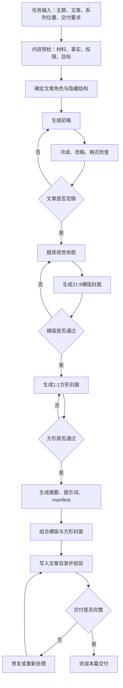

# 写文章与输出文章的整体流程梳理

> 版本说明：下文保留最初基于六个线程形成的场景梳理，便于回溯，不代表通用 Skill 规则。2026-10-05 的后续讨论已明确修正为“以单篇文章为基本单元，系列为可选关系”。新增的外部来源及修订框架见文末；两者冲突时，以用户最新确认的边界为准。

我把这 6 个线程合在一起看，实际形成的不是“一次生成一篇文章”，而是一个带人工确认闸门的文章生产闭环。

它可以先分成六个部分：

1. 内容准备与任务边界  
2. 文章立意、结构与写作  
3. 文章审查与定稿  
4. 视觉命题与配图生成  
5. 配套物料与组合输出  
6. 归档、交付与复盘  

整体主线可以先抽象成这样：



这里有一个很重要的边界：

文章内容先形成自己的定稿闭环，视觉生产再建立自己的闭环。封面不能替代文章审查，也不能在文章还没稳定时提前批量生成全部物料。

---

## 本次梳理所依据的深度链接

下面 6 个深度链接是这套流程的原始工作记录。它们不只是参考案例，也分别保留了文章叙事、视觉生成、性能优化和交付归档中的关键判断。后续把这套流程封装成 Skill 时，应把这些链接作为可回溯的依据，而不是只保留抽象后的规则。

### 1. 评估并构建第一个 Skill（2）

[打开深度链接](codex://threads/01a0ed8c-3c47-72f3-8097-63ef1f60f5d6)

作用：提供文章内容侧的主要依据。这里集中记录了产品叙事的推进方式、七篇文章各自的作用、第五篇两个核心体验的结构、从读者视角冷读全文，以及如何处理事后分类、抽象报告腔、章节衔接和 0.1 与未来设想的边界。

### 2. 评估并构建第一个 Skill（3）

[打开深度链接](codex://threads/01a1051d-72bf-7320-a266-6424637f8926)

作用：提供第一篇文章及其封面生成的实践记录，包括 21:9 横版和 1:1 方形封面、标题可读性、角标清理、第三方图片 API 的配置，以及“先生成、再确认、再继续”的人工确认方式。

### 3. 生成 21:9 文章配图

[打开深度链接](codex://threads/01a10620-6556-7051-90da-224322c22849)

作用：提供图片生成管线的工程依据。这里记录了从文章和视觉方法提炼提示词，到 API 返回格式兼容、缓存、尺寸规范化、原子写入、失败恢复和 21:9 输出的完整过程，也说明了为什么需要一个稳定的图片生成包装程序。

### 4. 延续 Good Idea 配图生成

[打开深度链接](codex://threads/01a10663-36b4-72d3-8bfc-47c7f7a57e12)

作用：提供“词义 → 视觉隐喻”的方法依据。这里明确了封面不能只是更换字体或套用上一张图的风格，而要让字形、构图、人物和材料关系共同表达本篇文章独有的观点，同时验证了逐篇、逐尺寸确认的生成节奏。

### 5. 检查文章配图

[打开深度链接](codex://threads/01a1068f-be27-76a1-a3f1-370943d132e5)

作用：提供流程优化和质量检查依据。这里拆解了单篇文章从读取正文、提炼语义 brief、生成两种尺寸到核验文件的耗时，区分了可以由代码完成的部分和必须保留模型或用户判断的部分，并形成了横版、方形并行批处理的方案。

### 6. 生成第 6、7 篇文章配图

[打开深度链接](codex://threads/01a106e1-6943-79b0-bf4a-7f1bc0b89319)

作用：提供批量输出、摘要、组合封面和归档迁移的交付依据。这里记录了第 6、7 篇封面的批量生成、公众号摘要 Markdown、横版与方形封面拼接、目标目录写入、复制与迁移的区别，以及生成后如何核验和清理工作区副本。

这 6 个链接合在一起，分别覆盖了：

```text
文章立意与叙事
  → 文章定稿与冷读
  → 视觉语义提炼
  → 图片生成管线
  → 并行与性能优化
  → 摘要、组合图与归档交付
```

后续 Skill 设计时，每个模块都应能回指到其中一个或多个原始线程，方便区分“已经验证过的工作方式”和“尚待讨论的设计设想”。

---

## 一、内容准备与任务边界

这一部分不是“收到主题就开始写”，而是先判断这篇文章有没有足够的材料，以及它在整个系列里承担什么作用。

当前线程里已经出现了几类必要判断。

### 1. 这是什么性质的写作

要先判断：

- 现实经历、现实产品、现实事件，还是虚构内容；
- 哪些内容来自用户亲历；
- 哪些内容来自外部来源；
- 哪些只是未来设想；
- 哪些内容可以公开，哪些属于私人讨论，不能直接写进文章。

这一步尤其重要，因为之前出现过一次把私人讨论直接转成公开案例的风险，后来才改成通用案例。

### 2. 材料够不够支撑目标篇幅

非虚构文章不能只靠几个抽象判断扩成一篇长文。

需要判断：

- 有没有具体场景；
- 有没有动作、时间、结果、失败、代价或变化；
- 有没有可以核验的来源；
- 用户要求的篇幅是否超过现有材料能够支撑的范围。

如果材料不足，有三个分支：

```text
材料不足
  ├─ 可以研究 → 先研究，再重新判断
  ├─ 依赖用户经历 → 一次追问必要信息
  └─ 不能研究也不能追问 → 缩小题目或缩短文章
```

不能用假设案例、重复解释或漂亮比喻去填补材料缺口。

### 3. 这篇文章在系列里做什么

这几天的七篇产品叙事实际上已经形成了一条系列结构：

1. 提出开放问题  
2. 通过第一次实验验证模式  
3. 把问题推进到认知连续性  
4. 找到一个念头刚刚发生的瞬间  
5. 说明产品怎样接住并继续发展这个念头  
6. 回看 Skill 如何逐渐长成项目  
7. 对最初的开放问题给出阶段性回答  

这不是所有文章都必须套用的七篇模板，但说明 Skill 里应该有一个“文章角色”判断。

如果是系列文章，需要先判断这篇是在：

- 提出问题；
- 讲实验；
- 深化问题；
- 提出产品立意；
- 展开产品机制；
- 复盘构建；
- 阶段性收束。

否则每篇文章都会重复交代背景，或者抢走相邻文章的任务。

---

## 二、文章立意、结构与写作

这部分的核心不是先列功能，而是先找到一条能够持续向前推进的逻辑线。

当前实践里比较稳定的顺序是：

```text
发生了什么
  ↓
我为什么会在意
  ↓
原来的理解在哪里遇到问题
  ↓
这个问题怎样推动下一步行动
  ↓
行动后看见了什么
  ↓
新的问题自然出现
```

以第五篇为例，经过多次调整后，文章的主体收敛成两个部分：

- 接住思考发生的瞬间；
- 让思考在关系中继续生长。

用户体验、差异化、产品架构、亮点，都应该从这两个阶段里自然长出来，而不能与这两个阶段并列成一张产品分析表。

这一部分有几个稳定规则：

- 先让读者进入具体场景，再解释产品机制；
- 先写事情怎样发生，再总结它说明了什么；
- 让机制从问题里出现，而不是先宣布机制名称；
- 使用“我们”保持共同经历的叙事位置；
- 区分已经跑通的 0.1、正在验证的能力和未来设想；
- 不把产品叙事写成需求说明书、分析报告或功能清单；
- 每一段都要增加新的事实、动作、关系、判断或后果。

这里尤其有一个反复修正的判断：

> 不能把“事后分类”当成叙事推进。

比如“这次反差让我把动态维护拆成两件事”就比“这次反差让我意识到，让模型维护知识库，除了要跟上知识本身的变化，还要看见一个人与这些知识之间不断变化的关系”更像报告。

---

## 三、文章审查与定稿

这一部分是第一个主要循环。

```text
初稿
  ↓
独立冷读
  ↓
检查事实、边界、衔接、语气
  ↓
用户反馈
  ↓
局部或整体改稿
  ↺
```

当前线程中实际发生过至少五类审查。

### 1. 冷启动审查

把每篇文章当成读者第一次看到的文章，检查：

- 读者知道发生了什么吗；
- 不看前文能理解最低限度背景吗；
- 有没有突然出现未解释的人名、工具、概念；
- 文章开头有没有真正进入事情；
- 结尾有没有提前说完下一篇的内容。

### 2. 系列衔接审查

检查相邻文章之间：

- 是否重复上一章已经讲过的内容；
- 是否出现时间倒跳；
- 是否某一篇承担了另一篇的功能；
- 章节之间的问题是否自然接上；
- 本篇结尾是否为下一篇留下正确的问题。

### 3. 抽象化与报告腔审查

重点查：

- 事后概念分类；
- “这说明了三个问题”式总结；
- 先给框架，再硬把材料塞进去；
- “用户、场景、需求、价值、架构”堆叠；
- 用抽象名词代替具体动作；
- 站在产品经理外部观察“用户”，而不是从“我们正在经历什么”出发。

### 4. 事实和权限审查

检查：

- 用户私人经历有没有未经授权进入公开文章；
- 0.1 已经实现的能力有没有被写成未来设想；
- 未来设想有没有被误写成已完成能力；
- 外部来源是否真的找到、读过并能支撑文章；
- 文章中的数据、引语、产品状态是否准确。

### 5. 语言与格式审查

包括：

- 禁用句式；
- 重复观点；
- 标题和小标题；
- 冒号、破折号、模型化路标；
- 人称是否统一；
- 脚本检查和人工冷读。

这一部分不能只靠脚本。脚本适合检查明确的硬规则，不能判断一段话是否像分析报告，也不能判断章节之间是否自然。

---

## 四、视觉命题与配图生成

文章定稿后，才进入视觉流程。

这一部分不是“给文章配一张好看的图”，而是从文章里提炼出一套专属的视觉关系。

稳定流程是：

```text
读取文章
  ↓
读取视觉方法与参考材料
  ↓
提炼语义 brief
  ↓
把词义转换为视觉隐喻
  ↓
设计横版构图
  ↓
设计方形构图
  ↓
生成与复核
```

语义 brief 至少应包含：

- 文章的核心词；
- 这个词真正的语义，而不是表面解释；
- 文章中的冲突或张力；
- 画面要发生的动作；
- 人物、材料、标题、空间之间的关系；
- 字体或概念字形的设计逻辑；
- 色彩和质感；
- 禁止出现的元素；
- 横版与方形的安全区要求。

这里有一个关键认识：

> 配图不是先选一种字体，再把标题放上去；而是让字形本身承担文章的观点。

“艺术字体”也不是简单在衬线体、无衬线体、手写体之间切换，而是要判断：

- 哪些笔画代表完整的形成过程；
- 哪些部分被压缩、残留或遮挡；
- 标题中的两个字之间发生了什么关系；
- 为什么这个字形只能属于这篇文章。

比如“想过”表达的不是怀旧，而是“过去完整发生过的思考，被压缩成今天可以调用的一点残留”。所以画面中才会出现旧材料、当前窗口和被拉回的一点内容。

---

## 五、图片生成中的确认循环

视觉流程里有两个循环。

### 第一层是单张图的生成循环

```text
生成
  ↓
技术检查
  ↓
语义和构图检查
  ↓
用户确认
  ├─ 通过 → 进入下一个尺寸
  └─ 不通过 → 修改视觉命题或提示词后重生成
```

技术检查包括：

- 尺寸；
- 比例；
- 文件格式；
- 图片是否完整；
- 标题是否清楚；
- 是否出现撕裂、损坏、错误文字；
- 是否有不应出现的序号、签名、Logo、水印；
- 缩略图和公众号裁切后是否仍然可读。

语义检查包括：

- 图是否真的表达文章；
- 是否只是套用了上一张图的风格；
- 是否把参考图硬搬过来；
- 是否保留了系列的质感，但又有本篇独立构图；
- 标题、人物、材料和动作之间是否形成关系。

### 第二层是横版到方形的尺寸循环

默认流程是：

1. 先生成 21:9 横版；
2. 用户确认横版；
3. 再生成 1:1 方形版；
4. 用户确认方形；
5. 再进入下一篇文章。

方形图通常需要独立构图，不能直接把横版裁切成正方形。横版和方形可以共享语义 brief，但空间关系、标题位置和安全区要重新设计。

这里存在一个重要判断分支：

```text
是否需要用户在不同尺寸之间确认？
  ├─ 需要 → 横版与方形串行生成
  └─ 不需要，且两种构图相互独立 → 可以并行生成
```

之前第 6、7 篇的图片生成已经验证了并行方式。两个尺寸共享同一份语义 brief，分别生成，最后统一检查，实际等待时间明显缩短。

但只要用户要求逐张确认，或者方形构图依赖横版方向，就应当保留串行闸门。

---

## 六、配套物料、组合输出与交付

文章定稿和图片确认后，才进入“输出完整交付包”。

每篇文章的交付物可以包括：

- 文章正文；
- 21:9 横版封面；
- 1:1 方形封面；
- 公众号摘要；
- 横版提示词；
- 方形提示词；
- 生成清单或 manifest；
- 横版与方形组合封面；
- 文章目录中的素材文件。

公众号摘要属于独立文案，不是简单截取文章开头。当前实践里形成了一个判断：

- 摘要要能脱离正文独立成立；
- 要根据这篇文章真正推进的问题单独提炼；
- 控制在平台限制内；
- 保存为 Markdown 文件；
- 每篇文章放进自己的 `素材` 目录。

组合封面则是一个完全可以程序化的步骤：

```text
横版封面
  + 方形封面
  ↓
横版放左侧
方形等比缩放后放右侧
  ↓
无裁切、无拉伸、无间距
  ↓
输出组合图
```

当前已经验证过的规则是：

- 左侧保留横版原始比例；
- 右侧方形按横版高度等比缩放；
- 最终组合图为 `3840×1152`；
- 默认禁止覆盖已有输出；
- 需要显式指定 `--force` 才能覆盖。

---

## 七、归档、迁移与交付核验

这部分之前暴露过一个流程问题：生成成功不等于交付完成。

正确的交付顺序应该是：

```text
生成到工作目录
  ↓
写入文章目标目录
  ↓
核对目标文件存在
  ↓
核对尺寸、格式、内容一致
  ↓
判断是复制还是迁移
  ↓
若明确要求迁移，再清理源副本
  ↓
报告最终保留位置
```

这里有三个判断：

### 1. 目标目录是否可写

生成图片成功，但写不进文章目录，仍然属于部分完成。

### 2. 是复制还是迁移

默认不能把同一个成品长期留在工作目录和文章目录两份。

但也不能一生成就删除源文件。应该先确认目标写入成功，再根据用户意图选择：

- 复制并保留源副本；
- 迁移并清理源副本；
- 保留压缩包作为恢复备份。

### 3. 是否可以宣布完成

只有以下内容都通过，才算完整交付：

- 文章正文存在；
- 图片存在于目标 `配图` 目录；
- 摘要存在于目标 `素材` 目录；
- 图片尺寸和比例正确；
- 组合封面结构正确；
- 提示词和 manifest 位置明确；
- 没有误加序号、签名或水印；
- 没有无意义的重复副本；
- 目标路径和最终保留范围清楚。

---

## 哪些环节适合交给程序，哪些必须保留判断

这会直接决定未来 Skill 的边界。

| 环节 | 适合程序化的部分 | 仍需模型或用户判断的部分 |
|---|---|---|
| 材料准备 | 找正文、提示词、图片、素材目录 | 哪些材料真正相关 |
| 文章预检 | 文件读取、来源记录、字数、格式 | 材料是否足够支撑文章 |
| 文章结构 | 保存结构模板、检查标题和篇次 | 这篇文章在系列里的真实作用 |
| 初稿 | 调用写作规则、生成草稿 | 叙事角度、判断力度、私人边界 |
| 改稿 | 硬规则扫描、重复词检查 | 是否像报告、是否自然、是否有品味 |
| 视觉 brief | 保存字段、编译提示词 | 词义、张力、视觉隐喻 |
| 图片生成 | API 调用、缓存、并行、重试 | 画面是否真的属于这篇文章 |
| 图片检查 | 尺寸、格式、完整性、文件路径 | 标题可读性、构图质量、用户是否认可 |
| 组合封面 | 完全可以程序化 | 是否适合公众号实际裁切 |
| 交付归档 | 写入、核验、清单、迁移检查 | 是否允许清理源副本、最终交付范围 |

所以，未来的 Skill 不应该是一个“一键生成文章和所有配图”的大黑盒，更适合做成一个编排器，内部调用几个边界清楚的模块：

```text
写作工作流 Skill
├── 内容预检
├── 系列角色与文章结构
├── 初稿生成
├── 冷读与改稿循环
├── 视觉命题提炼
├── 横版/方形封面生成
├── 摘要与素材输出
├── 组合封面处理
└── 归档与交付核验
```

目前最核心的循环可以归纳成四个：

1. 材料不足 → 研究、追问或缩短范围  
2. 初稿 → 冷读 → 用户反馈 → 改稿  
3. 图片生成 → 技术与语义检查 → 重新生成  
4. 交付写入 → 核验 → 修复或迁移  

最核心的判断闸门有八个：

1. 材料是否足够；  
2. 哪些内容可以公开；  
3. 文章在系列里的作用是什么；  
4. 哪些是已经实现的能力，哪些是未来设想；  
5. 是否需要参考图；  
6. 横版与方形应该串行还是并行；  
7. 图片是否在语义和技术上都通过；  
8. 交付物应该复制、迁移还是保留备份。  

我建议下一步先把这套框架再压缩成一个正式的 Skill 骨架，先确定输入、阶段、循环和判断闸门，再决定哪些步骤写成自动化脚本。现在还不需要直接写完整的 `SKILL.md`。

---

## 2026-10-05 后续讨论：文章基本单元与外部方法来源

### 用户明确提出的修正

用户指出：前一版抽象的是这次系列文章的写作场景，通用性不足；不一定每篇文章都是一个系列专题，数据结构应以文章作为基本单元。

因此，后续设计需要区分三层：

- 基本单元：一篇文章。每篇文章可以独立开始、修改、定稿和交付。
- 可选关系：系列、专题、栏目。它们组织多篇文章，但不是文章存在的前提。
- 可选输出：摘要、封面、正文插图、平台排版及其他附件。根据本次任务决定，不默认每篇文章都需要完整物料包。

产品实践者第一人称、七篇系列分工、21:9 与 1:1 双封面、组合封面、逐张人工确认，是前六个线程中的具体配置，不能直接成为通用流程的必填项。内容与视觉各有质量检查，但允许并行探索；只有依赖尚未确定正文的最终物料需要等待内容稳定。

### 新纳入的得到大脑来源

本次使用得到大脑搜索与笔记读取 Skill，检索写作主题并对照最近笔记列表，识别出 2026-10-05 集中保存的 16 条相关课程录音笔记。列表显示保存时间为 17:47–19:18；这是保存时间，不推断为课程录制时间。已取得这 16 条笔记的转写，并阅读与当前框架有关的段落；并非逐句审核全部课程内容。

以下链接来自得到大脑返回的笔记链接。它们是本次讨论的外部方法来源，不自动代表用户已经认领的观点，也不自动转成执行规则。它们属于同一批课程材料，不作为 16 个彼此独立的证据来源。

| 保存时间 | 外部来源 | 在本次讨论中的作用 |
|---|---|---|
| 17:47:57 | [热情下笔，冷静下刀：文章打磨与自我编辑方法分享](https://www.biji.com/note/1923279565879411864) | 区分作者表达与编辑检查；支持面向读者的冷读、结构修改及有边界的改稿循环。 |
| 18:34:19 | [写作的本质：跨时空的感知传递](https://www.biji.com/note/1923282553029154056) | 提醒文章可以传递知识，也可以传递感受；不能把所有文章都压成一个产品论证。 |
| 18:37:10 | [写作全光谱解析与持续写作成长指南](https://www.biji.com/note/1923282736639044720) | 区分自我表达、影响他人等写作目的及不同文体；不默认流量、传播或变现是每篇文章的目标。 |
| 18:41:29 | [读写一体SS卡片写作六步法全流程解析](https://www.biji.com/note/1923283014738074592) | 补充素材、选题、文体、核心表达、成文、编辑和反馈的前后关系；卡片作为可选材料入口。 |
| 18:44:36 | [标签管理系统搭建方法与知识体系构建逻辑讲解](https://www.biji.com/note/1923283215527871640) | 区分材料主题与材料作用，如观点、故事、数据、概念；支持按写作需要找素材，不在本次建立标签数据库。 |
| 18:45:49 | [分享打造优质观点的核心工具箱：从摄影视角理解写作的本质逻辑](https://www.biji.com/note/1923283293912099952) | 提醒“怎么看”决定表达角度；核心表达应源于作者自己的观察，而非堆积所有材料。 |
| 18:50:55 | [基于SCOPE模型的多维度写作选题与创作方法讲解](https://www.biji.com/note/1923283622477098096) | 提供从概念、观点、策略、故事等层次选择切口的方法；一篇文章不需要覆盖全部层次。 |
| 18:52:06 | [提炼写作观点、寻找写作选题的5种具体方法](https://www.biji.com/note/1923283698711680264) | 补充阅读、个人素材、问题和反馈等选题入口；使用他人材料时保留归属。 |
| 18:52:29 | [通过与问题缠斗提升观点文章思考深度的写作方法分享](https://www.biji.com/note/1923283723407742216) | 为观点型文章补充概念澄清、原因、边界、反例和行动追问；不要求所有文体强制论证。 |
| 18:58:36 | [写作表达技巧：让文章逻辑一波三折的方法](https://www.biji.com/note/1923284117472078960) | 检查真实的递进、转折与因果，避免材料平铺；不照搬套话或固定句式。 |
| 19:01:09 | [四类文体写作框架全解析：事实文、观点文、情感文、叙事文的底层逻辑拆解](https://www.biji.com/note/1923284281753426912) | 支持按表达任务选结构，允许混合文体；四类框架是参考策略，不是穷尽分类或唯一模板。 |
| 19:04:20 | [文章框架搭建方法讲解：通过拆解好文结构掌握写作逻辑](https://www.biji.com/note/1923284486839163872) | 关注段落功能和内容推进；不强制所有文章套同一种开头、结尾或升华。 |
| 19:07:32 | [内容标题创作核心方法论：从心智入口到精准触达受众](https://www.biji.com/note/1923284692996609288) | 检查标题是否面向目标读者、是否准确承诺正文内容；标题与封面关键词分开考虑。 |
| 19:13:40 | [围绕文字简洁化的写作方法](https://www.biji.com/note/1923285088133536736) | 去掉重复含义和过载句子，同时保留必要的不确定性、语气及叙事节奏。 |
| 19:16:59 | [写作结构优化课程](https://www.biji.com/note/1923285301808235672) | 区分网状思考、树状组织和线性阅读；大纲用于组织材料，成稿要让读者自然读下去。 |
| 19:18:47 | [讲好故事的核心方法分享：以感知传递为本质的故事创作技巧](https://www.biji.com/note/1923285417773427824) | 为叙事或情感分支提供关键瞬间、细节与感受传递的方法；不凭空替用户编造真实经历。 |

课程中的故事、数据与历史说法没有在本次另行核实，不能直接当作未来文章的事实依据。课程的个人习惯、数量口诀、固定修辞也不是通用硬约束。

### 修订后的文章单元：概念草案，而非数据库设计

一篇文章暂时只需围绕以下信息组织工作：

| 信息组 | 最小内容 |
|---|---|
| 写作意图 | 为什么写、主要给谁读；私人表达时，读者可以是自己。 |
| 核心表达 | 这一篇要传递的问题、判断、体验或故事；不强制都写成论点。 |
| 材料与来源 | 用户表达、真实经历、已有文稿和外部资料；标明归属、待核实之处与公开边界。 |
| 文稿与修改 | 当前稿、关键修改意见以及本次认可的版本；不预建复杂版本系统。 |
| 交付约定 | 本次交付哪些文件、存在哪里、如何判断完成。 |

文体、风格、篇幅、平台、系列关系、图片需求和反馈，是按需补充的配置。已有文稿可直接进入审查或输出阶段，不必重新从选题走起。材料不足时，不必强行生成文章；可以补充材料、缩小范围或保留为未成稿的表达。

### 整体可分为五部分

1. 任务与表达定位：确认当前从哪里开始、为什么写、给谁读、这一篇要表达什么。
2. 材料与内容发展：选择切口和主要文体，找材料、核查来源、深化表达。
3. 成文与编辑：组织结构、写初稿、从读者角度审查、修改并校准标题。
4. 按需输出：只生产约定的摘要、图片、平台格式或其他物料；正文也可以单独交付。
5. 交付与反馈：核验约定成果、保留来源；有真实反馈时用于当前修订或下一篇选题。

这是一条主线，并不要求每次走完全部阶段。目的、文体和材料允许相互修正；文章结构没有唯一固定模板。

### 循环流程：回到哪里，以及什么时候停止

| 循环 | 触发与返回 | 退出条件 |
|---|---|---|
| 表达与材料循环 | 表达不清或材料支撑不足 → 追问、检索、核查、调整角度或缩小范围。 | 已有材料足以支撑本篇承诺；仍缺关键事实或用户判断时，明确缺口并停下，不编造补齐。 |
| 成文与编辑循环 | 初稿 → 冷读 → 找到具体问题 → 修改；结构问题回到结构，事实问题回到材料。 | 达到本次约定的质量标准，没有未解决的关键问题；是否逐轮请用户确认取决于本次约定。 |
| 可选物料循环 | 有图片、摘要或排版任务时 → 生成 → 技术与语义检查 → 修正。 | 指定物料符合文章内容和平台要求；任务未要求物料时跳过。 |
| 交付核验循环 | 写入指定位置 → 核验 → 修复缺漏。 | 本次约定成果齐备、可打开且位置正确；不以固定全套附件为标准。 |
| 长期写作循环 | 完成文章后，有反馈或新感知 → 形成下一篇选题或一次明确修订。 | 这是跨文章的可选成长循环，不是当前文章永远无法完成的理由。 |

### 判断流程：决定路线，而非自动反复重写

- 入口判断：是从原始想法开始，还是已有初稿、定稿，只需改稿或输出？
- 目的与表达判断：主要传递事实、解释、判断、经验、感受还是故事？结构如何匹配？
- 来源判断：材料是否足够、哪些待核实、哪些属于他人、哪些不宜公开？
- 关系判断：是否属于系列？只有属于系列时，才检查篇间分工、重复和衔接。
- 质量判断：本篇是否表达清楚、结构适配、来源可靠、保留作者声音？是否需要用户作关键决定？
- 输出判断：是否需要摘要、图片、平台排版？具体规格和风格是什么？
- 完成判断：是否满足本次交付约定？归档不是发布；发布、覆盖、迁移或清理另按用户授权执行。

判断负责选择路径；循环负责解决某个明确问题。两者应分别描述，不能把每个判断都写成无期限返工。

### 两类来源如何进入后续 Skill 讨论

六个 Codex 深度链接保留“这次实际怎么写、怎么改、怎么做图与交付”的案例证据；得到大脑课程补充“还可能怎样选题、匹配文体、发展表达与编辑”的候选方法。用户最新提出的文章基本单元决定设计边界。

后续正式骨架可先压缩为：文章任务入口 → 按需阶段 → 分支判断 → 有退出条件的修改循环 → 交付核验。案例与课程放在参考层，主规则只保留跨文章可复用的行为。本节仍为待讨论方案，未创建或安装可执行 Skill，也未写入正式知识卡片。

---

## 2026-10-05 综合梳理：结合自身实践与课程的写作工作流（讨论稿）

这次把你的实践和课程放在一起，我建议把写作流程理解为：**围绕一篇文章，从真实表达出发，逐步发展内容，再完成与本次目标相匹配的交付。**

课程补充“怎样把内容想清楚、写出来”；你的实践补充“怎样与 AI 协作、检查质量、制作物料并可靠交付”。两者结合，不是把所有步骤叠加，而是提炼共同主线，再按任务选择分支。

## 一、先分清三种层次

**素材积累是长期背景，文章生产是本次主流程，系列和平台物料是可选扩展。**

- 素材层：原始表达、经历、卡片、阅读笔记、外部资料，可以被不同文章复用。
- 文章层：一篇文章有自己的意图、核心表达、所用来源、文稿和交付约定。
- 扩展层：系列关系、摘要、封面、正文插图、平台排版，根据需要增加。

因此，课程以卡片组织素材，与你提出“以文章为基本单元”不冲突：它们分别回答“材料如何复用”和“写作任务如何组织”。我们不需要规定所有素材必须先做成卡片，也不需要规定每篇文章必须加入系列。

## 二、一篇文章的主流程，分为六个部分

```text
启动本篇任务
    ↓
发展核心表达与材料 ↺
    ↓
组织结构与写出初稿
    ↓
冷读、修订与定稿 ↺
    ↓
按需制作输出物料 ↺（无需求则跳过）
    ↓
交付核验与收尾

有新的反馈或感知 → 当前稿的明确修订，或下一篇文章
```

这表示通常的推进关系，不是不可改变的顺序。已有初稿可直接进入编辑，已有定稿可直接进入输出；探索性写作也可以先写片段，再回头找到角度。

### 1. 启动本篇任务：确定要做什么，保留最初的表达

先识别这次任务是从想法写文章、整理材料、修改已有稿，还是只做文章输出。

需要弄清楚的是：为什么写、主要给谁读、目前有什么输入、本次希望交付什么。已有答案就沿用，不把它变成长问卷。

从你的实践中应当保留一个重要边界：先保留你实际说过和经历过的内容，再进行抽象。AI 可以帮助澄清，不能为了更像文章而替你添加经历、立场或结论。

这一阶段的结果，是一份简短的任务共识，而不是完整文章大纲。

### 2. 发展核心表达与材料：找到这一篇真正要说的东西

这里把选题、切口、文体和材料放在一起反复校准。

选题是“写什么”；切口是“从哪里看”；核心表达是“这一篇到底要传递什么”。同一个选题，可以写成经验复盘、方法说明、观点讨论或个人叙事。

课程里的文体区分提供了参考：

- 解释问题或介绍方法，需要概念、步骤、依据和适用边界。
- 表达观点，需要理由、证据，以及必要的反例和限制。
- 讲述经历，需要事件、行动、结果及变化。
- 传递感受，需要具体细节和体验，不必强行补成论证。

它们可以混合，但应知道本篇主要承担什么任务。

然后围绕表达找材料，而不是把所有相关材料都塞进去。区分你的经历、你的判断、他人的观点、可核实事实与未来设想。材料也可能推翻原来的判断，因此不能只找支持既定结论的资料。

材料不足时，补充研究、追问必要经历、缩小范围，或暂不成稿。不能靠扩写和虚构事实补齐。

这一阶段的结果，是相对清楚的核心表达、可用材料和明确缺口。

### 3. 组织结构与写出初稿：把作者的思考转换成读者的阅读路径

结构的任务是让读者理解内容如何推进，不是展示我们做过多少分类。

课程所说的“网状思考—树状组织—线性输出”，与你实践中反复纠正“事后分类、报告腔、功能清单”的问题能够接上：大纲可以用于内部整理，但成稿需要自然的前后关系。

你这次产品叙事里“发生了什么—为什么在意—采取行动—看见变化”的写法，适合经验和实践叙事；它不应成为所有文章的固定模板。

写初稿时，重点是把内容展开。可以使用工作标题，可以保留明确标出的待核实内容，不必一边写一边追求每句话都完美。

这一阶段的结果，是一份可审查的完整初稿，而不只是材料拼接或层层标题。

### 4. 冷读、修订与定稿：先改内容，再改文字

这里需要切换到读者视角，但仍然保留作者自己的意思和声音。

建议按这个优先级检查：

1. 事实、来源与公开边界：有没有不可靠的说法，是否混淆经历、推测和设想？
2. 核心表达：本篇真正想说的是否清楚？有没有在不同方向之间摇摆？
3. 结构与阅读：最低限度背景是否充分？段落是否推进？是否重复或跳跃？
4. 文字与标题：句子是否过载、含义是否重复、语气是否自然？标题是否准确承诺正文？

修改应定位问题：

- 事实缺口，回到材料。
- 核心表达偏移，回到角度和任务。
- 顺序不清，调整结构。
- 内容成立但表达拖沓，再修改文字。

标题可以较早探索，但最终要与正文校准。冷启动可读性、保留作者声音、避免抽象空话，是从你的实践中值得保留的检查原则；篇间衔接只在系列分支中检查。

达到本次约定的质量标准、关键问题得到解决，才进入定稿。确认节奏按任务约定，不默认每次小修改都要求你批准，也不允许 AI 在关键立场或公开边界上代替你决定。

### 5. 按需制作输出物料：围绕本篇内容，而非默认生成全套附件

这一部分主要吸收你这次实际完成的封面、摘要和输出经验。

先判断本次需要什么，再分别处理：

- 摘要：脱离正文也能成立，准确表达文章，不简单截取开头。
- 封面或插图：从本篇内容提炼视觉命题，再选择构图和风格。
- 平台排版：依据实际平台要求调整，不反过来随意改变作者意思。
- 其他附件：只有交付约定需要时才制作。

图片同时检查技术完整性和表达适配性。尺寸正确，不代表它表达了文章；语义贴切，也不能忽略错字、裁切和文件损坏。

21:9、1:1、组合封面和逐张确认，都是这次案例中的配置。可以保留为可调用方案，不写成每篇必走的步骤。探索可以提前进行，但依赖正文的最终物料要与认可的正文版本一致。

### 6. 交付核验与收尾：以本次约定判断完成

你的实践提供了一个很重要的提醒：生成成功不等于交付完成。

需要检查正文与约定物料是否对应、能否打开、是否写入指定位置，以及还有哪些未完成项。若只要求正文，就不因缺少图片而判断未完成。

保存、发布、复制、迁移、覆盖和删除是不同动作。完成文件不等于获得公开发布授权，也不默认清理源副本。

收尾时给出明确结果：交付位置、认可版本、完成范围，以及仍需处理的缺口。

有真实反馈时，可以修订当前文章，也可以形成下一篇选题；反馈不是当前文章永远不能结束的理由。

## 三、循环流程和判断流程，分别怎样工作

循环解决明确问题，并且需要退出条件：

| 循环 | 什么时候发生 | 什么时候结束 |
|---|---|---|
| 表达与材料循环 | 想说的还不清楚，或材料不足以支撑 | 表达与材料相匹配；否则明确缺口，缩小范围或停下 |
| 初稿与编辑循环 | 冷读发现事实、角度、结构或文字问题 | 达到本次质量标准，关键问题解决 |
| 可选物料循环 | 图片、摘要或排版未符合约定 | 技术检查与内容适配检查通过 |
| 交付核验循环 | 文件、位置或版本存在缺漏 | 本次约定成果齐备且核验通过 |

判断则决定走哪条路：

- 入口判断：从想法、材料、初稿还是定稿开始？
- 内容判断：本篇表达什么，采用什么主要文体，材料是否够用？
- 扩展判断：是否属于系列，是否需要物料和平台适配？
- 权限判断：哪些可以公开，哪些决定需要你确认？
- 完成判断：是否达到本次约定，而不是是否生成了最多东西？

尤其要区分“补材料”和“请你作决定”。前者可以继续研究；后者涉及你的经历、立场或授权时，应当停在具体问题上，不无限重试。

## 四、未来 Skill 应当保留的最小骨架

这版可以先收敛为：

**识别入口 → 明确本篇任务 → 发展表达与材料 → 成文 → 定位问题并修订 → 按需输出 → 核验交付。**

文章的信息结构也围绕这条主线：任务意图、核心表达、材料来源、当前文稿、认可版本、交付约定；系列关系与物料需求作为可选信息。

结合 `yao-meta-skill` 的轻量边界原则，主规则只保留上述推进方式、分支和停止条件；文体技巧、课程例子、视觉方案与这次系列实践放在参考层，不把全部经验塞进主规则。这次仍然是框架讨论，没有创建正式 Skill。

来源分工保持明确：六个 Codex 线程是实践案例，得到大脑的 16 条笔记是外部方法来源。来源链接与各自作用已保留在本文前面的来源登记中；课程课次未明确的地方不补编编号。

我建议先确认这一层：**写作工作流负责帮助你把一篇文章从当前状态推进到约定成果；它提供方法与检查，但不替你决定值得表达的是什么。**
